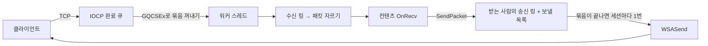

# Windows IOCP 네트워크 라이브러리

> **최적화가 처리량을 61% 떨어뜨린 원인을 측정으로 추적해, 우연에 기대던 송신 구조를 설계로 고친 C++ 서버 네트워크 라이브러리입니다.**

IOCP와 `AcceptEx` 기반의 TCP 서버 라이브러리를 DLL로 만들고, 그 위에 에코·채팅 서버와 검증·부하 클라이언트를 직접 구현했습니다. 빠르게 만드는 것만큼 **숫자가 왜 그렇게 나왔는지 설명하는 것**을 목표로 삼았습니다.

C++ · Windows · IOCP · Winsock2 · Visual Studio 2022

## 핵심 성과

| 무엇을                  | 결과                                        |
| ----------------------- | ------------------------------------------- |
| 처리량 −61%의 원인 추적 | 대조 조건으로 분리, 우연한 모아 보내기 발견 |
| 모아 보내기를 설계로    | 에코 처리량 +57–58%                         |
| 브로드캐스트로 확장     | 방 16 전달 처리량 12.7–12.9배               |
| 잘못된 기본값 발견      | 채팅 전달 2.6배, 최대 지연 68 → 15ms        |
| 고부하 합격 시험        | 서버 CPU 1.86/2에서 정상 클라 끊김 0        |
| 연결 수락 방식 결정     | 같은 용량에서 `accept`의 1.24배, 실패율 1/6 |

**모아 보내기**는 여러 메시지를 `WSASend` 한 번에 실어 보내는 것입니다.

> **수치를 읽을 때:** 서버와 클라이언트를 같은 PC에서 돌린 루프백 측정이며, 크기보다 방향이 중요합니다. 2026-11-05 이전 측정은 서버가 최적화 없는 `/Od` 빌드였음을 뒤늦게 발견해, 송신 경로 수치를 옛 커밋까지 `/O2`로 다시 빌드해 전부 다시 쟀습니다(Core i5-8600, 조건별 3회 중앙값, [원본과 표](실험폴더/portfolio_o2_2026_11_05/결과.md)). 연결 수락 수치는 지금은 쓰지 않는 실험용 서버로 잰 당시 값이고, 지연 주입 시험의 끊김 횟수도 당시 값입니다.

## 구조



| 경로                 | 내용                                   |
| -------------------- | -------------------------------------- |
| `_lib/NetworkLib/`   | 라이브러리 DLL                         |
| `_lib/ProtocolLib/`  | 서버·클라이언트 공용 패킷 헤더         |
| `networkLibProject/` | 서버 exe - 에코·채팅 컨텐츠, 설정 읽기 |
| `EchoClient/`        | 정확성 검증 클라이언트                 |
| `LoadClient/`        | 처리량 측정·시험용 부하 클라이언트     |
| `tools/`             | 자동 시험·측정 스크립트                |
| `portfolio/`         | 설계·실험 문서                         |

컨텐츠는 라이브러리를 상속해 콜백만 구현합니다. 아래는 에코 서버의 핵심입니다.

```cpp
class EchoServer final : public NetworkLib
{
protected:
	void OnRecv(const uint64_t id, const char* payload, const int32_t len) override
	{
		SendPacket(id, payload, len); // 링에 넣기만 하고, 라이브러리가 묶음 끝에 모아 보낸다
	}
	// OnAccept, OnRelease 생략
};
```

## 대표 사례: 송신 경로

**1. skip을 켜자 `WSASend` 호출이 8배로 늘어 처리량이 61% 떨어졌습니다.** 완료 통지를 줄이려고 `FILE_SKIP_COMPLETION_PORT_ON_SUCCESS`(이하 skip)를 켜고 끔과 비교했습니다. 32B × 16 부하, 워커 2에서 `WSASend` 1번당 메시지가 7.8개 → 1개, 서버 CPU/패킷이 1.67 → 6.72us로 늘고, 처리량은 77.9만 → 30.2만 패킷/s가 됐습니다(워커 4는 −51%).

**2. 대조 조건으로 원인을 분리했습니다.** 원래 패킷마다 `WSASend`를 1번 부르는 4KB × 1은 skip을 켜도 호출 수가 그대로였고, 완료 통지가 절반으로 줄었는데도 처리량은 +0.6–1.2%로 거의 같았습니다. 완료 통지 절감이 아니라 **모아 보내기가 사라진 것**이 원인이었습니다.

**3. 지금까지의 처리량이 우연에 기대고 있었습니다.** 세션당 `WSASend`는 1건만 겁니다. 그 완료를 처리하기 전까지(16–24us) 메시지가 링에 쌓였다가 한 번에 나가고 있었습니다. skip은 이 창을 없앴을 뿐입니다.

**4. 모아 보내기를 설계로 보장했습니다.** 수신 처리 중에는 링에 쌓기만 하고 끝에서 한 번만 보내도록 바꿔 에코 처리량이 57–58% 올랐습니다. 대조 조건인 4KB × 1은 차이가 없었습니다.

**5. 브로드캐스트에서 같은 문제를 다시 찾았습니다.** 4번은 수신 처리 중인 세션에게 가는 응답만 모았기 때문에, 다른 세션에게 보내는 채팅에서는 skip을 켜면 메시지마다 `WSASend`를 불렀습니다. 방 16, 워커 2에서 skip 끔과 비교하면 `WSASend` 1번당 메시지가 68–139개 → 1.06개, 전달 처리량이 945만 → 30.4만/s로 약 31분의 1이 됐습니다. 받는 사람마다 모으도록 넓혀 skip을 켠 상태의 방 16 전달 처리량이 12.7–12.9배가 됐습니다.

**6. 기본값까지 다시 검증했습니다.** 무응답 판정을 넣자, 하트비트를 잘 보내던 클라이언트가 끊겼습니다(`/Od` 당시). 에코로만 재서 정한 기본값이 채팅에서 처리를 밀리게 하고 있었습니다. 보내는 시점을 "꺼낸 완료 묶음의 끝"으로 바꾸자 `/O2`에서 전달 처리량이 397만 → 1013만/s, 최대 지연이 33–68ms → 14–15ms가 됐고, 에코에서는 손해가 없었습니다. 수 초 기아는 `/O2`에서 재현되지 않았습니다.

**7. 재측정으로 결론도 고쳤습니다.** `/Od` 때는 이 구조에서 skip 켬이 끔보다 31–35% 빨랐지만, `/O2`에서는 처리량 차이가 없었습니다(+0.5–2.9%). skip을 기본값으로 유지한 근거를 처리량에서 **송신 완료 대기 제거**(1723 → 7us, 워커 2)와 지연 p99 감소(9.9 → 7.6ms, 워커 2)로 바꿨습니다.

상세: [송신 경로 분석](networkLibProject/docs/portfolio_send_path_draft_2026_10_26.md) · [브로드캐스트 송신 경로](portfolio/broadcast_send_path_2026_11.md)

## 사례: 연결 수락 방식 결정

**처음 비교에서 나온 `AcceptEx`의 우위는 방식이 아니라 용량 차이였고, 조건을 맞추자 워커 1개에서는 `accept`보다 나빴습니다.** 그래서 조건을 맞춰 다시 재고 워커 수까지 정했습니다.

**1. 첫 비교는 공정하지 않았습니다.** 양쪽 backlog를 200으로 맞추자 `AcceptEx`(워커 1, 걸어둔 소켓 1000개)가 처리량 1.4배, 거절 0이었습니다. 그런데 시험해 보니 `AcceptEx`의 수용 용량은 **backlog + 걸어둔 소켓 수**였습니다. 용량이 1200 대 200이었던 것입니다.

**2. 수용 용량을 256으로 맞추자 결과가 달라졌습니다.** 동시 연결 512개를 5분간 조건별 1회씩 건 결과입니다.

| 서버         | 수락/s | 실패율 | 실패가 난 초 |
| ------------ | ------ | ------ | ------------ |
| `accept` 1   | 10,854 | 0.038% | 50/294       |
| `AcceptEx` 1 | 10,215 | 0.336% | 263/295      |
| `AcceptEx` 2 | 13,455 | 0.006% | 19/300       |
| `AcceptEx` 4 | 12,507 | 0%     | 0/300        |

- 숫자는 수락 스레드(워커) 수입니다.
- 워커 1개는 `accept`보다 실패율이 약 9배 높았습니다.
- 워커 2개부터 역전되어 처리량 1.24배, 실패율 1/6이 됐습니다.

**3. 걸어둔 소켓이 모자라면 느려집니다.** 용량 700으로 거절을 없앤 상태에서, 소켓 200 + backlog 500은 소켓 500 + backlog 200보다 36% 느렸습니다(8,556 vs 13,366/s). 워커 1개에서 소켓을 1000개에서 56개로 줄이면 완료 처리 비용은 거의 같은데(64.1 vs 68.3us) 완료를 기다리는 시간이 17배(3.5 → 58.0us)가 됐습니다. 연결이 왜 늦게 들어오는지는 확인하지 못했습니다.

**결정:** `AcceptEx`, 워커 2개, 걸어둘 소켓은 동시 접속 예상치 이상으로 넉넉하게 둡니다(`server.cfg`의 `slotCnt = 500`).

**한계:**
- 대부분 조건별 1회 측정이고, 같은 조건도 측정 간 변동이 큽니다(워커 1, 소켓 56개: 10,215 vs 7,955/s).
- `accept`는 스레드 1개만 쟀고, 스레드를 늘린 비교는 없습니다.
- 수락 직후 끊는 부하로 수락 경로만 쟀으며, 측정에 쓴 실험용 서버는 지금 라이브러리와 다릅니다.

상세: [연결 수락 비교 결론](accept_vs_acceptex_결론_2026_10_21.md)

## 설계 결정과 근거

| 결정                     | 근거                                       |
| ------------------------ | ------------------------------------------ |
| `AcceptEx` + 같은 IOCP   | 워커 2개부터 `accept`보다 빠르고 실패 적음 |
| 세션 ID = 세대 + 슬롯    | 슬롯 재사용 시 ABA 방지                    |
| 해제는 항상 워커에서     | 콜백 재진입과 컨텐츠 락 데드락 방지        |
| 수신 링 > 최대 패킷      | `static_assert`로 링 가득 참 경우 제거     |
| 송신 링 32KB, 차면 끊기  | 메모리를 고정하고 판정을 단순하게          |
| 느린 클라는 L7 시간 판정 | TCP는 window 0인 연결을 끊지 않음          |
| 라이브러리는 메커니즘만  | 무응답·방 정책은 컨텐츠가 결정             |
| 부하별 모으기, 타이머 X  | 한가하면 지연 없이, 바쁘면 많이 합침       |

## 트러블슈팅

**`OnRelease` 재진입 데드락**
- **증상:** 카운트를 0으로 만든 스레드가 바로 해제하면, 컨텐츠의 `SendPacket` 안에서 `OnRelease`가 불려 락이 겹칠 수 있습니다(설계 중 발견).
- **해결:** 0이 되면 `PostQueuedCompletionStatus`로 해제 작업을 넣어 항상 워커에서 처리합니다.

**끊기 경쟁**
- **증상:** `CancelIoEx` 직전에 성공한 수신이 수신을 다시 걸어 연결이 살아남을 수 있습니다.
- **해결:** 끊기 플래그로 새 I/O를 막고, I/O를 건 **뒤에** 플래그를 다시 확인해 취소합니다.

**부하 중 정상 클라이언트 끊김**
- **증상:** 정상 에코 클라이언트가 가끔 넘침으로 끊겼습니다. 재현이 16회 중 1회로 드물어 수정 효과를 횟수로 보일 수 없었습니다.
- **해결:** 완료 처리 지연을 주입하는 시험을 만들어 수정 전 15초당 244–386회, 수정 후 0회로 확인했습니다(`/Od` 당시 값).

**막 받은 세션을 무응답으로 끊음**
- **증상:** 정상 부하에서 활발한 세션일수록 무응답으로 끊겼습니다.
- **원인:** 감시 스레드의 `now`보다 워커가 쓴 시각이 나중이면, 부호 없는 뺄셈이 약 42억이 됩니다.
- **해결:** 시각을 먼저 읽고 `now`를 나중에 읽습니다.

전체 기록: [README_ERRORS.md](README_ERRORS.md)

## 검증 방법

- **바이트 단위 에코 검증:** 시드 기반 패킷 스트림을 무작위로 잘라 보내고, 돌아온 바이트를 모두 비교합니다. 불일치하면 클라이언트가 바로 멈춥니다.
- **방 순번 검사:** 채팅 메시지의 방 순번이 +1씩 오는지 봅니다. 방 옮기기 시험에서는 일부러 넣은 버그(방에서 안 빼기, 구성원 늦게 추가)가 바로 잡히는 것까지 확인했습니다.
- **섞인 클라이언트 합격 시험:** 서버 CPU 1.86/2의 고부하에서 6종의 클라이언트를 동시에 붙입니다(3회 모두 같은 판정).

| 클라이언트     | 세션 | 결과                   |
| -------------- | ---- | ---------------------- |
| 정상 채팅      | 256  | 끊김 0, 최대 지연 27ms |
| 하트비트만     | 64   | 끊김 0                 |
| 입장 후 침묵   | 64   | 무응답으로 끊김        |
| 입장 안 함     | 64   | 입장 시간 초과로 끊김  |
| 받지 않는 채팅 | 64   | 넘침으로 끊김          |
| 비정상 헤더    | 64   | 비정상 패킷으로 끊김   |

이 시험의 목적은 한계 수치가 아니라 **서버가 바쁠 때 정상 클라이언트를 오판하지 않는지** 보는 것입니다. 상세: [합격 시험](portfolio/mixed_clients_test_2026_11_03.md) · [연결 감시 설계](portfolio/timeout_design.md) · [방 옮기기 검사](portfolio/room_move_test_design.md)

## 측정을 믿기 위해 한 일

- **측정 도구부터 의심:** 처음 잰 처리량은 서버가 아니라 검증 클라이언트의 한계였습니다. 그래서 부하 전용 클라이언트를 만들고, 서버와 클라이언트 CPU를 항상 함께 봅니다.
- **비교 방법 고정:** 같은 실행 안에서 조건을 번갈아 돌리고, 회차마다 순서를 바꿔 중앙값을 냅니다. 두 PC의 숫자는 섞지 않습니다.
- **혼입 변수 제거:** 프로파일러 비용이 GQCS 쪽에 더 붙는 것을 발견해, 처리량과 비용 분해를 별도 실행에서 잽니다.
- **빌드 설정 오류 발견:** 서버 Release가 디버깅용 `/Od`로 남아 있던 것을 찾아 `/O2`로 복원하고, 옛 커밋까지 다시 빌드해 비교 수치를 다시 쟀습니다. 그 결과 −82%가 −61%로 바뀌고, skip의 처리량 이득 +31–35%와 수 초 기아는 재현되지 않아 결론을 고쳤습니다.
- **측정 스크립트도 검증:** 재측정 중 옛 커밋 클라이언트에 메시지 크기 설정이 없어 4KB 대조 조건이 32B로 돈 것을 로그로 찾아 다시 쟀습니다.
- **해석 실수도 기록:** 송신 완료 2–4ms를 ACK 대기로 잘못 읽은 일 등을 [README_ERRORS.md](README_ERRORS.md) 4장에 남겼습니다.

## 한계와 다음 단계

**한계**
- 모두 루프백 측정이라 CPU와 커널 TCP 스택을 서버·클라이언트가 나눠 씁니다. 크기는 이 환경의 값이고, 서버 단독 한계는 재지 못했습니다.
- 부하가 closed-loop라 포화 전 지연은 재지 못했습니다.
- **정상 클라이언트 넘침 끊김이 남아 있습니다.** 방을 계속 옮기는 부하(워커 4)에서는 15초에 최대 수십 건, 방을 옮기지 않아도 다른 PC(노트북)의 워커 8에서는 15초에 265–1445건 났습니다(재측정 범위 밖). 방을 옮기지 않는 부하는 위 측정 PC의 워커 1–6에서 0건이고, 기본값인 워커 2의 섞인 클라이언트 시험에서도 정상 클라이언트 끊김은 0건입니다.
- 위 측정 PC에서는 채팅 처리량이 워커 2에서 가장 높고 워커를 늘리면 떨어집니다(993만 → 워커 4 846만/s). 다른 PC에서는 반대라 원인을 확정하지 못했습니다.
- 즉시 완료 반복 중 송신이 묶음 끝까지 밀리는 문제를 알고 있으며, 지금은 고치지 않기로 했습니다.
- 암호화는 아직 없습니다.

**다음 단계**
1. 방 인원 상한 등 컨텐츠 제약으로 넘침 보완
2. 직렬화 버퍼 + 참조 카운트로 브로드캐스트 복사 줄이기
3. 세션별 키 암호화

## 빌드와 실행

Windows, Visual Studio 2022(MSVC), x64가 필요합니다.

```powershell
$msbuild = "C:\Program Files\Microsoft Visual Studio\2022\Community\MSBuild\Current\Bin\MSBuild.exe"
& $msbuild networkLibProject\networkLibProject.sln /p:Configuration=Release /p:Platform=x64 /m /v:minimal /nologo
& $msbuild EchoClient\EchoClient.sln /p:Configuration=Release /p:Platform=x64 /m /v:minimal /nologo
& $msbuild LoadClient\LoadClient.sln /p:Configuration=Release /p:Platform=x64 /m /v:minimal /nologo

# 서버 + 에코 클라이언트 → 세션 0 복귀 확인 → 정상 종료 확인
.\tools\echo_test.ps1 -Name demo -RunSec 15

# 섞인 클라이언트 합격 시험
.\tools\mixed_test.ps1 -Rounds 3 -RunSec 25
```

서버는 `networkLibProject/server.cfg`를 읽습니다. `chatRoomCnt`가 0이면 에코, 1 이상이면 채팅 서버로 동작합니다.
