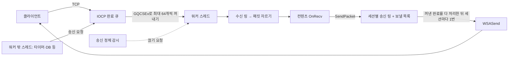

# Windows IOCP 네트워크 라이브러리

> **게임 서버용 TCP 네트워크 라이브러리를 C++로 직접 설계했습니다. 주요 설계 결정마다 왜 그렇게 정했는지, 어떤 안을 버렸는지, 그 판단이 맞는지 어떻게 확인했는지를 함께 남겼습니다.**

IOCP와 `AcceptEx` 기반의 서버 라이브러리를 DLL로 만들고, 그 위에 에코 서버·시험 클라이언트와 게임 서버(텍스트 TRPG + 경매장 + MySQL + 운영 툴, 별도 로그인 서버와 암호 통로)를 구현했습니다. 방 브로드캐스트처럼 메시지가 몰리는 상황에서 "빠르다"보다 **숫자가 왜 그렇게 나왔는지 설명할 수 있는 설계**를 목표로 삼았습니다.

C++ · Windows · IOCP · Winsock2 · Visual Studio 2022 · MySQL · Redis · Windows CNG(RSA) · libsodium

## 구조



- **스레드:** 워커가 완료와 컨텐츠 콜백을 직접 처리합니다. 컨텐츠가 만든 다른 스레드(타이머, DB 스레드)도 `SendPacket`을 부를 수 있지만, 실제 `WSASend`와 세션 해제는 IOCP를 거쳐 항상 워커가 합니다. 한 프로세스에 라이브러리 객체가 여럿이어도(게임 서버 + 운영자 서버) 다른 객체의 워커는 워커 밖 스레드로 취급합니다.
- **세션:** 시작할 때 최대 수만큼 만들어 재사용하고, 컨텐츠는 포인터가 아니라 ID로만 다룹니다. 수명은 I/O 카운트 하나로 관리합니다.
- **컨텐츠 경계:** 컨텐츠는 라이브러리를 상속해 `OnAccept`, `OnRecv`, `OnRelease`를 구현합니다. 워커 밖 스레드(DB 등)가 세션을 쓰는 동안에는 `HoldSession`/`UnholdSession`으로 해제를 막을 수 있고, DB 처리 자체는 컨텐츠가 맡습니다. 방 정책이나 게임 규칙은 라이브러리가 모릅니다.

상세: [라이브러리 구조](portfolio/architecture.md)

## 설계 결정

| 영역        | 선택               | 버린 안          | 이유                 |
| ----------- | ------------------ | ---------------- | -------------------- |
| 연결 수락   | `AcceptEx`         | `accept`         | 워커 2개↑ 실패 1/6   |
| 완료 꺼내기 | GQCSEx 64개씩      | GQCS             | 꺼낸 만큼 모아 보냄  |
| 워커 수     | 동시 실행 수 따로  | 코어 수만큼 깨움 | 깨면 덜 모음         |
| 컨텐츠 실행 | 워커가 바로 처리   | 큐 + 로직 스레드 | 큐 경합·복사 없음    |
| 세션 수명   | 카운트 + 해제 비트 | 세션 락          | 송신마다 락 없음     |
| 송신 버퍼   | 세션별 링 32KB     | 직렬화 버퍼 공유 | 컨텐츠 세션별 암호화 |
| 송신 시점   | 완료 처리 후 1번   | 즉시 송신        | 방 전달 12.7배       |
| 무응답 클라 | 시간 기준 판정     | TCP에 맡김       | 수신 윈도우 0        |
| 배포        | DLL + 헤더 분리    | 정적 라이브러리  | 내부 수정은 DLL 교체 |

- **연결 수락:** 연결이 몰릴 때 `AcceptEx`는 워커 2개에서 거절 비율 0.006%로 `accept` 전담 스레드(0.038%)의 1/6, 처리량은 1.24배였습니다. 워커 1개에서는 오히려 거절이 9배 많았는데, 미리 걸어 둔 소켓이 모자라 백로그를 거친 연결을 워커가 기다렸기 때문입니다(PC A, 5분 측정). → [연결 수락](portfolio/cases/accept.md)
- **세션 수명:** 해제를 정확히 한 번 하는 것은 세션 락으로도 할 수 있지만, 그러려면 송신·세션 찾기마다 락을 잡아야 하고 "아무도 안 쓰는 순간"은 결국 카운트로 알아야 합니다. 그래서 카운트 하나에 해제 표시 비트를 넣어 락 없이 처리합니다.
- **배포:** 함수 내부·세션 구조·링 크기만 바뀌면 서버를 다시 빌드하지 않고 DLL만 바꿔도 됩니다. `NetworkLib` 클래스의 멤버나 가상 함수가 바뀌면 서버도 다시 빌드해야 합니다.
- **워커 수:** 처리량은 워커 수가 아니라 IOCP 동시 실행 수가 정합니다. 동시에 깨어 있는 워커가 많으면 한 번에 꺼내는 완료가 줄어 덜 모아 보내기 때문입니다(워커 4: 884만 → 동시 실행 수 2로 묶자 1048만/s).
- **컨텐츠 실행 스레드의 대가:** 서로 다른 세션의 콜백이 여러 워커에서 동시에 불리므로 공유 데이터는 컨텐츠가 락으로 보호합니다. 같은 세션의 `OnRecv`는 순서대로 불리고 동시에 불리지 않습니다.
- **송신 버퍼:** 라이브러리는 받은 바이트를 그대로 전송만 하고, 암호화는 컨텐츠가 세션마다 다른 키로 맡습니다. 그러면 같은 메시지라도 받는 세션마다 보내는 바이트가 달라져, 한 번 직렬화한 버퍼를 여러 세션이 공유할 수 없습니다. 그래서 공유 버퍼 대신 세션마다 고정 크기 송신 링을 두고, 컨텐츠가 세션별로 만든 바이트를 각자의 링에 받는 구조로 설계했습니다.
- **송신 시점:** `SendPacket`은 받는 세션의 송신 링에 쌓기만 하고 `WSASend`는 모아서 부릅니다. `WSASend` 1번 비용(약 7us)은 실린 메시지 수와 거의 상관없어, 언제 부르느냐가 처리량을 정합니다. 채팅 방 16에서 세 시점을 비교했습니다(PC B, 워커 2, 3회 중앙값).
  - **부하 패턴:** 부하 클라이언트는 256세션(방 16명씩 16개)이 각자 32바이트 메시지 16개를 `send` 한 번으로 보내고, 자기 16개가 방송으로 모두 돌아오면 곧바로 다음 16개를 보냅니다. 속도 제한 없이 서버가 처리하는 만큼 계속 보내는 포화 부하입니다.
  - **메시지마다 → 수신 1건마다:** 메시지 하나를 처리할 때마다 보내던 것을, 수신 버퍼에서 꺼낸 메시지를 다 처리한 뒤 한 번 보내도록 바꿨습니다. `WSASend`당 메시지 1.1 → 16.4개, 전달 30.4만 → 387만/s(12.7배), 방 락을 잡은 시간 94 → 0.91us.
  - **수신 1건마다 → 꺼낸 완료마다(지금):** 수신 1건에는 보낸 사람 한 명의 메시지만 있어 16개씩만 모였습니다. GQCSEx로 꺼낸 완료(최대 64개)를 다 처리한 뒤로 넓히자 59개, 411만 → 993만/s(2.4배), 지연 p99 20.7 → 7.6ms. 타이머로 기다리지 않아 한가하면 곧바로 나갑니다.
- 영역마다 하는 일, 고려한 다른 안, 근거, 남은 고민은 [라이브러리 구조](portfolio/architecture.md)에 있습니다.

## 가장 오래 고민한 것

**1. 송신 경로: 우연에 기대던 모아 보내기를 설계로**

완료 통지를 줄이려고 skip(`FILE_SKIP_COMPLETION_PORT_ON_SUCCESS`)을 켜자 처리량이 77.9만 → 30.2만 패킷/s로 61% 떨어졌습니다. 패킷마다 원래 `WSASend`를 1번 부르는 4KB 대조 조건은 차이가 없어, 원인이 완료 통지가 아니라 **송신 완료가 늦게 처리되는 동안 우연히 일어나던 모아 보내기가 사라진 것**임을 분리했습니다. 수신 처리 끝에서 한 번만 보내도록 바꿔 에코 처리량이 57–58% 올랐고, 받는 사람마다 모으도록 넓혀 방 16 전달 처리량이 12.7–12.9배가 됐습니다. → [송신 경로](portfolio/cases/send_path.md) · [브로드캐스트](portfolio/cases/broadcast.md)

**2. 세션 수명: 해제는 정확히 한 번, 그리고 항상 워커에서**

해제는 IOCP에 작업으로 넣어 항상 워커에서 하는데, 넣기(`PostQueuedCompletionStatus`)가 실패한 분기만 그 자리에서 해제했습니다. 이 분기는 방 락을 쥔 채 `OnRelease`가 같은 락을 다시 잡는 경로였습니다. 실패를 강제해 재현했고(20회 중 4회 서버 종료), 복구할 방법이 없는 실패라 그 자리 해제를 없애고 로그를 남긴 뒤 멈추도록 바꿨습니다. 그 뒤 카운트의 63번 비트를 해제 표시로 써서 잠금 없이 해제를 한 번만 일어나게 했고, 리뷰에서 네 판이 실행 순서 시나리오로 깨진 끝에 "표시는 수락에서 새 ID를 쓴 뒤에만 지운다"는 결론을 얻었습니다. → [데드락 경로](portfolio/cases/deadlock.md) · [세션 수명](portfolio/cases/session_lifetime.md)

**3. 무응답 클라: 정상 클라를 잘못 끊지 않는 판정**

상대의 수신 윈도우가 0이면 TCP는 연결을 끊지 않습니다. 그래서 라이브러리는 송신 요청 시각(`WSASend`를 건 시각)이 기준보다 오래된 연결을 송신 정체로 끊고, 컨텐츠는 하트비트로 수신 타임아웃을 판정하도록 나눴습니다. 어려웠던 것은 끊는 것보다 **잘못 끊지 않는 것**이었습니다. 부호 없는 시각 뺄셈이 활발한 세션을 끊었고, 서버가 밀린 동안 하트비트를 보내던 클라가 끊겼고, 워커에 맡긴 송신의 큐 대기를 송신 정체로 세기도 했습니다. 시각 뺄셈과 큐 대기 오판은 재현한 뒤 고쳤고, 하트비트 클라가 끊긴 문제는 송신을 모으는 범위의 기본값을 바꾼 뒤 사라졌습니다(원인은 확정하지 못함). 지금 구조에서는 서버 CPU가 포화된 상태에서도 정상 클라 끊김 0을 확인했습니다. → [연결 감시](portfolio/design/timeout.md)

**4. 서버 객체가 둘이 되자: "아무 스레드에서나"의 범위**

게임 서버에 운영자 포트를 같은 라이브러리의 두 번째 서버 객체로 붙이려다, 라이브러리가 "이 스레드가 워커인가"를 `static thread_local` 워커 번호 하나로만 판단한다는 것을 찾았습니다. 운영자 서버의 워커가 게임 플레이어에게 `SendPacket`하면 자기를 게임 서버의 워커로 여겨, **게임 세션을 자기 송신 목록에 올리고 게임 서버의 카운터를 자기 번호로 읽습니다.** 워커마다 소속 객체를 함께 기록하고, 다른 객체의 워커는 워커 밖 스레드처럼 워커에게 송신을 맡기도록 고쳤습니다. 객체가 하나일 때는 드러나지 않던 문제라, "`SendPacket`은 아무 스레드에서나"라는 약속에 다른 객체의 워커도 들어간다고 범위를 다시 적었습니다. → [에러 기록 2-13](README_ERRORS.md)

## 검증

에코 서버와 시험 클라이언트로 라이브러리가 깨질 수 있는 지점을 하나씩 시험했습니다. 아래 케이스는 모두 확인했습니다.

| 테스트 케이스                       | 실험한 이유                                                                                                                                                                                |
| ----------------------------------- | ------------------------------------------------------------------------------------------------------------------------------------------------------------------------------------------ |
| 회신 메시지의 순서·내용 검증        | 서버는 여러 응답을 모아 `WSASend` 한 번으로 보낸다. 모으는 과정에서 순서가 바뀌거나 내용이 섞이지 않는지 확인한다                                                                          |
| 송신을 멈춘 뒤 오지 않는 회신 검사  | 세션마다 송신 플래그로 `WSASend`를 하나씩만 건다. 플래그를 잘못 다루면 링에 보낼 데이터가 남아 있는데도 아무도 `WSASend`를 걸지 않는다. 요청을 멈추고 기다려 이 현상이 일어나는지 확인한다 |
| 비정상 길이 헤더 차단               | 헤더의 길이를 최대보다 크게 조작한 패킷이 오면, 라이브러리가 그 데이터를 기다리지 않고 즉시 끊는지 확인한다                                                                                |
| 송신 정체 연결 끊기                 | 상대가 읽지 않아 수신 윈도우가 0이 되어도 TCP는 연결을 끊지 않는다. 그런 연결이 서버 자원을 계속 잡지 않도록 라이브러리가 송신 정체 시간 기준으로 끊는지 확인한다                          |
| 클라 종료 방식(FIN·RST)별 세션 해제 | 끊김은 FIN이면 0바이트 수신 완료로, RST면 실패한 I/O 완료로 온다. 경로마다 I/O 카운트를 정확히 내려야 한다 - 놓치면 세션 슬롯이 돌아오지 않고, 두 번 내리면 사용 중인 세션이 해제된다      |
| 서버 종료 시 정리                   | 종료할 때 세션이 0으로 돌아오고, 워커·감시 스레드가 남은 일 없이 멈추는지 확인한다                                                                                                         |

- 측정 자체도 의심했습니다. 클라이언트가 먼저 포화된 숫자, 프로파일러 비용이 한쪽에만 붙은 비교, 최적화가 꺼진 `/Od` 빌드를 찾아 결론까지 고쳤습니다. → [에러와 해석 실수 기록](README_ERRORS.md)

## 사용 예: 텍스트 TRPG 던전 + 경매장 서버

이 라이브러리 위에 2–4명이 파티를 꾸려 던전을 도는 텍스트 TRPG와, 얻은 아이템을 사고파는 경매장을 만들었습니다. 가입·로그인은 별도 로그인 서버가 맡고, 게임 데이터는 MySQL에 저장하고, 아이템 회수·접속 제재는 별도 운영 툴로 합니다. **에코로는 시험할 수 없던 라이브러리 기능을 실제 게임에서 썼습니다.**

- **방송:** 파티 락·경매장 락 안에서 `SendPacket`해 받는 사람 모두 같은 순서로 받습니다(라이브러리는 송신 링에 넣기만 해 락 안이 짧습니다).
- **워커 밖 스레드의 송신:** 턴 마감 타이머(10초 지나면 자동 방어), 경매 마감 타이머, DB 스레드가 `SendPacket`을 부르고, 실제 송신은 라이브러리가 워커로 넘깁니다.
- **세션 붙잡기:** 입장 요청은 DB 스레드가 Redis 확인·계정 읽기를 하는 동안 `HoldSession`으로 해제를 막아, 그사이 끊겨도 `OnRelease`가 결과 전송 뒤에 옵니다. 워커는 Redis·DB를 기다리지 않습니다.
- **로그인 서버와 암호화:** 비밀번호는 로그인 서버에서만 다룹니다(Argon2id + 솔트 + 페퍼, 인증 스레드). 로그인하면 일회용 세션 키를 Redis에 30초 넣고, 게임 서버는 키 자체가 아니라 "그 연결의 무작위 값에 대한 증명"을 받아 확인한 뒤 키를 지웁니다(가로챈 요청을 다른 연결에서 못 씀). 로그인 구간은 RSA 2048(Windows CNG)만 씁니다 - 서버·클라가 접속마다 임시 키 쌍을 쓰고, 클라에 박아 둔 서버 고정 키는 서명만 하므로 고정 키가 유출돼도 녹화해 둔 로그인 패킷은 풀리지 않습니다. 서버 임시 키 쌍(만드는 데 약 50ms)은 백그라운드 스레드가 미리 만들어 두어, ClientHello만 보내는 접속 400개를 연 직후에도 정상 로그인이 0.4초 안에 됩니다. 게임 구간은 세션 키에서 나눈 방향별 키로 모든 메시지를 XChaCha20-Poly1305로 암호화합니다(libsodium). 모든 송신이 세션 송신 락 안에서 순번을 매겨 암호화하므로, 워커·타이머·DB 스레드가 같은 세션에 동시에 보내도 순번이 어긋나지 않습니다.
- **서버 객체 두 개:** 한 프로세스에 게임 서버와 운영자 포트(127.0.0.1, 운영자 키, 5초 인증 기한)를 같은 라이브러리로 띄웁니다(위 4번).
- **데이터 정합성:** 골드·아이템이 바뀔 때마다 데이터와 로그를 트랜잭션 하나로 저장하고, 저장 요청은 메모리를 바꾼 락 안에서 넣어 DB에도 같은 순서로 들어갑니다. 경매 뒤 DB 골드 = 메모리 골드 = 로그 합계, 재시작 때 열린 경매 환불, DB 연결을 끊은 뒤 재연결을 시험했습니다.

- **시험:** 자동 시험 8개(로그인 24판정 포함, 판정 68개와 이유는 [테스트 케이스](portfolio/verification/game_test_cases.docx))가 시험마다 계정을 직접 만들어 몇 번이든 다시 돌릴 수 있습니다. 장시간 시험은 봇 30개가 5시간 동안 던전 2.4만 판·입찰 5.7만 번·재접속 2,200번을 돌린 동안 메모리 53MB 그대로, 정상 클라 끊김 0, DB 저장 실패 0, DB 골드 = 로그 합계였습니다. 로그인 서버를 RSA로 바꾼 뒤 5시간 다시 돌린 시험도 로그인 2,236번 중 인증 실패 0, 정상 클라 끊김 0, 미리 만든 키가 떨어진 적 0, 두 서버 메모리 증가 없음이었습니다.

상세: [게임 서버 구조](portfolio/game_architecture.md) · [장시간 시험](portfolio/verification/game_soak.md) · [게임 서버 설계](portfolio/design/게임서버_설계.docx) · [로그인 서버 설계](portfolio/design/login_server.docx) · [처리 흐름(클라 한 명의 순서, 단계마다 스레드·락)](portfolio/design/게임서버_흐름.docx)

## 한계

- 모두 루프백 측정이라 서버·클라이언트가 CPU와 커널 TCP 스택을 나눠 씁니다. 서버 단독 한계는 재지 못했습니다.
- 부하가 closed-loop라 포화 전 지연은 재지 못했습니다.
- 즉시 완료가 이어지는 동안 송신이 꺼낸 완료를 다 처리할 때까지 밀리는 문제를 알고 있으며, 지금은 고치지 않기로 했습니다.

## 빌드와 실행

Windows, Visual Studio 2022(MSVC), x64가 필요합니다.

```powershell
$msbuild = "C:\Program Files\Microsoft Visual Studio\2022\Community\MSBuild\Current\Bin\MSBuild.exe"
& $msbuild Echo\Echo.sln /p:Configuration=Release /p:Platform=x64 /m /v:minimal /nologo
```

- 서버(`Echo\x64\Release\EchoServer.exe`)는 `Echo/Server`에서 실행해 `server.cfg`를 읽습니다. Q로 종료합니다.
- 시험 클라이언트(`EchoClient.exe`)는 `Echo/Client`에서 실행해 `client.cfg`의 역할별 세션 수(`normalCnt`, `badHeaderCnt`, `sendStallCnt`)대로 접속합니다. S로 일시정지·다시 시작, Q로 종료하며 마지막 줄에 `[result] PASS/FAIL`을 출력합니다.
- 테스트 케이스를 자동으로 다시 돌리는 명령은 [테스트 케이스](portfolio/verification/test_cases.md#다시-돌리기)에 있습니다.

게임 서버는 MySQL(8.0 이상), Redis(세션 키), libsodium 1.0.22 MSVC판(환경 변수 `SODIUM_DIR`)이 필요합니다.

```powershell
& $msbuild Game\Game.sln /p:Configuration=Release /p:Platform=x64 /m /v:minimal /nologo
```

- `Game/Server/db.cfg.example`을 `db.cfg`로 복사해 DB 접속 정보와 운영자 키를 채운 뒤 빌드합니다(`db.cfg`는 저장소에 올리지 않습니다). 테이블은 처음 실행할 때 만들어집니다.
- `Game/Server/db.cfg`에 Redis 주소·비밀번호도 채웁니다. 로그인 서버는 `Game/Login/login.cfg.example`을 `login.cfg`로 복사하고 페퍼를 채운 뒤, `LoginServer.exe --genkey`로 RSA 서명 키를 만들어 비밀 키는 `login.cfg`에, 공개 키는 `Game/Login/server_public.cfg`에 넣습니다(클라 빌드 때 복사됩니다).
- `Game\x64\Release`에서 `LoginServer.exe`(포트 33002), `GameServer.exe`(포트 33000, 운영자 포트 127.0.0.1:33001), `GameClient.exe`(콘솔 게임 클라이언트, `register`·`login` 뒤 `help`로 명령), `AdminTool.exe`(운영 툴)를 실행합니다.

| 경로                          | 내용                                                   |
| ----------------------------- | ------------------------------------------------------ |
| `_lib/NetworkLib/`            | 라이브러리 DLL                                         |
| `_lib/ProtocolLib/`           | 서버·클라이언트 공용 패킷 헤더                         |
| `Echo/Server/`                | 에코 서버                                              |
| `Echo/Client/`                | 에코 시험 클라이언트(select 스레드 1개)                |
| `Game/Server/`                | 게임 서버(파티·던전·경매장·MySQL 저장·운영자 포트)     |
| `Game/Login/`                 | 로그인 서버(가입·로그인, Argon2id, RSA 키 미리 만들기) |
| `Game/Protocol/`              | 게임 프로토콜, 입장 증명, RSA 로그인 통로, 게임 통로   |
| `Game/Client/`, `Game/Admin/` | 게임 콘솔 클라이언트, 운영 툴                          |
| `Game/Data/`                  | 시나리오 데이터(CSV)                                   |
| `tools/`                      | 에코·게임 자동 시험, 덤프 요약, 문서·코딩 규칙 검사    |
| `portfolio/`                  | 구조, 사례, 검증, 설계 기록                            |
