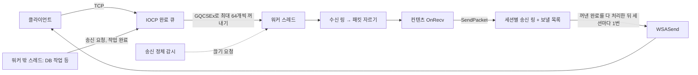

# Windows IOCP 네트워크 라이브러리

> **게임 서버용 TCP 네트워크 라이브러리를 C++로 직접 설계했습니다. 주요 설계 결정마다 왜 그렇게 정했는지, 어떤 안을 버렸는지, 그 판단이 맞는지 어떻게 확인했는지를 함께 남겼습니다.**

IOCP와 `AcceptEx` 기반의 서버 라이브러리를 DLL로 만들고, 그 위에 에코·채팅 서버와 검증·부하 클라이언트를 구현했습니다. 방 브로드캐스트처럼 메시지가 몰리는 상황에서 "빠르다"보다 **숫자가 왜 그렇게 나왔는지 설명할 수 있는 설계**를 목표로 삼았습니다.

C++ · Windows · IOCP · Winsock2 · Visual Studio 2022

## 구조



- **스레드:** 워커가 완료와 컨텐츠 콜백을 직접 처리합니다. 컨텐츠가 만든 다른 스레드(예: DB 작업 스레드)도 `SendPacket`과 작업 완료를 부를 수 있지만, 실제 `WSASend`와 세션 해제는 IOCP를 거쳐 항상 워커가 합니다.
- **세션:** 시작할 때 최대 수만큼 만들어 재사용하고, 컨텐츠는 포인터가 아니라 ID로만 다룹니다. 수명은 I/O 카운트 하나로 관리합니다.
- **컨텐츠 경계:** 컨텐츠는 라이브러리를 상속해 `OnAccept`, `OnRecv`, `OnRelease`(DB 같은 작업을 맡기면 `OnJobComplete`도)를 구현합니다. 방 정책이나 게임 규칙은 라이브러리가 모릅니다.

상세: [라이브러리 구조](portfolio/architecture.md)

## 설계 결정

| 영역        | 선택               | 버린 안          | 이유                 |
| ----------- | ------------------ | ---------------- | -------------------- |
| 연결 수락   | `AcceptEx`         | `accept`         | 실패 `accept`의 1/6  |
| 완료 꺼내기 | GQCSEx 64개씩      | GQCS             | 꺼낸 만큼 모아 보냄  |
| 워커 수     | 동시 실행 수 따로  | 코어 수만큼 깨움 | 깨면 덜 모음         |
| 컨텐츠 실행 | 워커가 바로 처리   | 큐 + 로직 스레드 | 큐 경합·복사 없음    |
| 세션 수명   | 카운트 + 해제 비트 | 세션 락          | 해제 정확히 1번      |
| 송신 버퍼   | 세션별 링 32KB     | 직렬화 버퍼 공유 | 컨텐츠 세션별 암호화 |
| 송신 시점   | 완료 처리 후 1번   | 즉시 송신        | 방 전달 12.7배       |
| 무응답 클라 | 시간 기준 판정     | TCP에 맡김       | 수신 윈도우 0        |
| 배포        | DLL + 헤더 분리    | 정적 라이브러리  | 서버 재컴파일 불필요 |

- **워커 수:** 처리량은 워커 수가 아니라 IOCP 동시 실행 수가 정합니다. 동시에 깨어 있는 워커가 많으면 한 번에 꺼내는 완료가 줄어 덜 모아 보내기 때문입니다(워커 4: 884만 → 동시 실행 수 2로 묶자 1048만/s).
- **컨텐츠 실행 스레드의 대가:** 서로 다른 세션의 콜백이 여러 워커에서 동시에 불리므로 공유 데이터는 컨텐츠가 락으로 보호합니다. 같은 세션의 `OnRecv`는 순서대로 불리고 동시에 불리지 않습니다. 단 작업 완료 콜백 `OnJobComplete`는 같은 세션의 다른 콜백과 동시에 불릴 수 있습니다.
- **송신 버퍼:** 라이브러리는 받은 바이트를 그대로 전송만 하고, 암호화는 컨텐츠가 세션마다 다른 키로 맡습니다. 그러면 같은 메시지라도 받는 세션마다 보내는 바이트가 달라져, 한 번 직렬화한 버퍼를 여러 세션이 공유할 수 없습니다. 그래서 공유 버퍼 대신 세션마다 고정 크기 송신 링을 두고, 컨텐츠가 세션별로 만든 바이트를 각자의 링에 받는 구조로 설계했습니다.
- **송신 시점:** `SendPacket`은 받는 세션의 송신 링에 쌓기만 하고 `WSASend`는 모아서 부릅니다. `WSASend` 1번 비용(약 7us)은 실린 메시지 수와 거의 상관없어, 언제 부르느냐가 처리량을 정합니다. 채팅 방 16에서 세 시점을 비교했습니다(PC B, 워커 2, 3회 중앙값).
  - **부하 패턴:** 부하 클라이언트는 256세션(방 16명씩 16개)이 각자 32바이트 메시지 16개를 `send` 한 번으로 보내고, 자기 16개가 방송으로 모두 돌아오면 곧바로 다음 16개를 보냅니다. 속도 제한 없이 서버가 처리하는 만큼 계속 보내는 포화 부하입니다.
  - **메시지마다 → 수신 1건마다:** 메시지 하나를 처리할 때마다 보내던 것을, 수신 버퍼에서 꺼낸 메시지를 다 처리한 뒤 한 번 보내도록 바꿨습니다. `WSASend`당 메시지 1.1 → 16.4개, 전달 30.4만 → 387만/s(12.7배), 방 락을 잡은 시간 94 → 0.91us.
  - **수신 1건마다 → 꺼낸 완료마다(지금):** 수신 1건에는 보낸 사람 한 명의 메시지만 있어 16개씩만 모였습니다. GQCSEx로 꺼낸 완료(최대 64개)를 다 처리한 뒤로 넓히자 59개, 411만 → 993만/s(2.4배), 지연 p99 20.7 → 7.6ms. 타이머로 기다리지 않아 한가하면 곧바로 나갑니다.
- 영역마다 하는 일, 고려한 다른 안, 근거, 남은 고민은 [라이브러리 구조](portfolio/architecture.md)에 있습니다.

## 가장 오래 고민한 것

**1. 송신 경로: 우연에 기대던 모아 보내기를 설계로**

완료 통지를 줄이려고 skip(`FILE_SKIP_COMPLETION_PORT_ON_SUCCESS`)을 켜자 처리량이 77.9만 → 30.2만 패킷/s로 61% 떨어졌습니다. 패킷마다 원래 `WSASend`를 1번 부르는 4KB 대조 조건은 차이가 없어, 원인이 완료 통지가 아니라 **송신 완료가 늦게 처리되는 동안 우연히 일어나던 모아 보내기가 사라진 것**임을 분리했습니다. 수신 처리 끝에서 한 번만 보내도록 바꿔 에코 처리량이 57–58% 올랐고, 받는 사람마다 모으도록 넓혀 방 16 전달 처리량이 12.7–12.9배가 됐습니다. → [송신 경로](portfolio/cases/send_path.md) · [브로드캐스트](portfolio/cases/broadcast.md)

**2. 세션 수명: 해제는 정확히 한 번, 그리고 항상 워커에서**

해제는 IOCP에 작업으로 넣어 항상 워커에서 하는데, 넣기(`PostQueuedCompletionStatus`)가 실패한 분기만 그 자리에서 해제했습니다. 이 분기는 방 락을 쥔 채 `OnRelease`가 같은 락을 다시 잡는 경로였습니다. 실패를 강제해 재현했고(20회 중 4회 서버 종료), 복구할 방법이 없는 실패라 그 자리 해제를 없애고 로그를 남긴 뒤 멈추도록 바꿨습니다. 그 뒤 카운트의 63번 비트를 해제 표시로 써서 잠금 없이 해제를 한 번만 일어나게 했고, 리뷰에서 네 판이 실행 순서 시나리오로 깨진 끝에 "표시는 수락에서 새 ID를 쓴 뒤에만 지운다"는 결론을 얻었습니다. → [데드락 경로](portfolio/cases/deadlock.md) · [세션 수명](portfolio/cases/session_lifetime.md)

**3. 무응답 클라: 정상 클라를 잘못 끊지 않는 판정**

상대의 수신 윈도우가 0이면 TCP는 연결을 끊지 않습니다. 그래서 라이브러리는 송신 요청 시각(`WSASend`를 건 시각)이 기준보다 오래된 연결을 송신 정체로 끊고, 컨텐츠는 하트비트로 수신 타임아웃을 판정하도록 나눴습니다. 어려웠던 것은 끊는 것보다 **잘못 끊지 않는 것**이었습니다. 부호 없는 시각 뺄셈이 활발한 세션을 끊었고, 서버가 밀린 동안 하트비트를 보내던 클라가 끊겼고, 워커에 맡긴 송신의 큐 대기를 송신 정체로 세기도 했습니다. 시각 뺄셈과 큐 대기 오판은 재현한 뒤 고쳤고, 하트비트 클라가 끊긴 문제는 송신을 모으는 범위의 기본값을 바꾼 뒤 사라졌습니다(원인은 확정하지 못함). 지금 구조에서는 서버 CPU가 포화된 상태에서도 정상 클라 끊김 0을 확인했습니다. → [연결 감시](portfolio/design/timeout.md)

## 검증

설계 결정마다 **깨지면 안 되는 것**을 테스트 케이스로 뽑고, 하나씩 깨 보는 실험으로 확인합니다.

| 케이스                     | 깨 보는 방법              | 결과             |
| -------------------------- | ------------------------- | ---------------- |
| 잘린 패킷도 바이트 그대로  | 무작위로 잘라 보내고 비교 | 불일치 0         |
| 모아 보내도 순서·누락 없음 | 방 순번 검사, 방 이동     | 버그 주입 검출   |
| 밀려도 정상 클라 유지      | 송신 완료 처리 지연 주입  | 끊김 → 0         |
| 해제 실패 시 데드락 없음   | 해제 작업 전달 실패 강제  | 데드락 없이 멈춤 |
| 고부하에서 오판 없음       | CPU 포화 + 문제 클라 4종  | 정상 클라 끊김 0 |

- 22개 케이스 중 11개를 확인했습니다. 연결 폭주·부하 중 종료·장시간 같은 나머지 케이스는 아직 정리하는 중입니다. → [테스트 케이스](portfolio/verification/test_cases.md)
- 측정 자체도 의심했습니다. 클라이언트가 먼저 포화된 숫자, 프로파일러 비용이 한쪽에만 붙은 비교, 최적화가 꺼진 `/Od` 빌드를 찾아 결론까지 고쳤습니다. → [에러와 해석 실수 기록](README_ERRORS.md)

## 사용 예: 오목 대전 서버

(작성 예정) 이 라이브러리로 로그인, 매칭, 대전, 결과 저장을 하는 1:1 오목 서버를 만듭니다. 턴 타이머 스레드의 송신, MySQL 조회를 워커 밖에서 처리하는 작업 API, 대전 중 끊김 처리를 실제로 씁니다.

## 한계

- 모두 루프백 측정이라 서버·클라이언트가 CPU와 커널 TCP 스택을 나눠 씁니다. 서버 단독 한계는 재지 못했습니다.
- 부하가 closed-loop라 포화 전 지연은 재지 못했습니다.
- 방을 계속 옮기는 부하(워커 4)에서 정상 클라이언트의 송신 버퍼 초과 끊김이 15초에 수십 건 납니다. 기본값인 워커 2의 섞인 클라이언트 시험에서는 0건입니다.
- 즉시 완료가 이어지는 동안 송신이 꺼낸 완료를 다 처리할 때까지 밀리는 문제를 알고 있으며, 지금은 고치지 않기로 했습니다.

## 빌드와 실행

Windows, Visual Studio 2022(MSVC), x64가 필요합니다.

```powershell
$msbuild = "C:\Program Files\Microsoft Visual Studio\2022\Community\MSBuild\Current\Bin\MSBuild.exe"
& $msbuild networkLibProject\networkLibProject.sln /p:Configuration=Release /p:Platform=x64 /m /v:minimal /nologo
& $msbuild EchoClient\EchoClient.sln /p:Configuration=Release /p:Platform=x64 /m /v:minimal /nologo
& $msbuild LoadClient\LoadClient.sln /p:Configuration=Release /p:Platform=x64 /m /v:minimal /nologo

# 서버 + 에코 클라이언트 → 세션 0 복귀 확인 → 정상 종료 확인
.\tools\echo_test.ps1 -Name demo -RunSec 15

# 섞인 클라이언트 합격 시험
.\tools\mixed_test.ps1 -Rounds 3 -RunSec 25
```

서버는 `networkLibProject/server.cfg`를 읽습니다. `chatRoomCnt`가 0이면 에코, 1 이상이면 채팅 서버로 동작합니다.

| 경로                 | 내용                                   |
| -------------------- | -------------------------------------- |
| `_lib/NetworkLib/`   | 라이브러리 DLL                         |
| `_lib/ProtocolLib/`  | 서버·클라이언트 공용 패킷 헤더         |
| `networkLibProject/` | 서버 exe - 에코·채팅 컨텐츠, 설정 읽기 |
| `EchoClient/`        | 정확성 검증 클라이언트                 |
| `LoadClient/`        | 처리량 측정·시험용 부하 클라이언트     |
| `tools/`             | 자동 시험·측정 스크립트                |
| `portfolio/`         | 구조, 사례, 검증, 설계 기록            |
