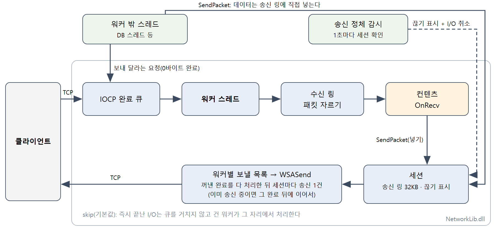
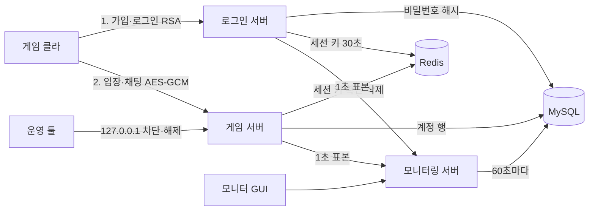
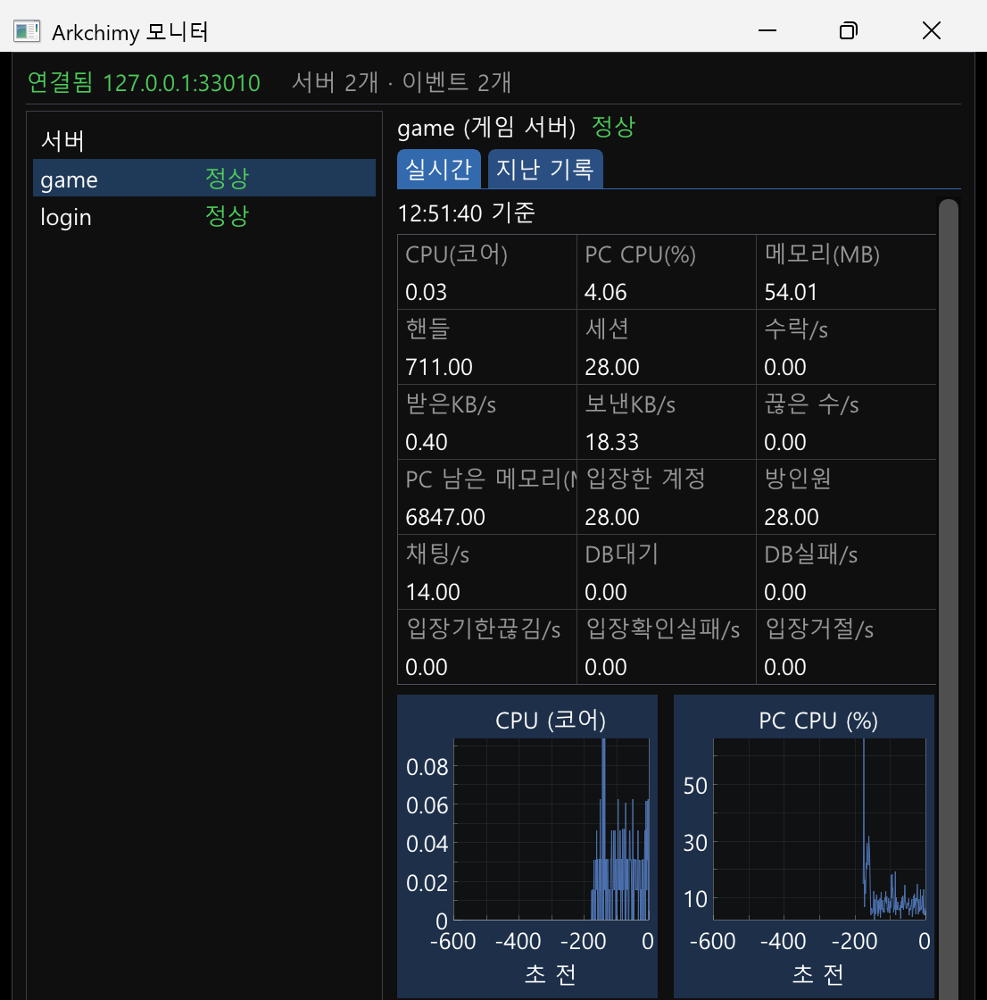

# Windows IOCP 네트워크 라이브러리

> **게임 서버용 TCP 네트워크 라이브러리를 C++로 직접 설계했습니다. 주요 설계 결정마다 왜 그렇게 정했는지, 어떤 안을 버렸는지, 그 판단이 맞는지 어떻게 확인했는지를 함께 남겼습니다.**

IOCP와 `AcceptEx` 기반의 서버 라이브러리를 DLL로 만들고, 그 위에 서버 네 개를 올렸습니다: 에코 서버(라이브러리 시험용), 로그인 서버, 게임 서버(인증 분산, 암호화 채널, MySQL, Redis, 운영 툴), 그리고 두 서버의 상태를 1초마다 모아 DB에 남기는 모니터링 서버와 GUI 클라입니다. 목표는 "빠르다"보다 **숫자가 왜 그렇게 나왔는지 설명할 수 있는 설계**였습니다.

C++ · Windows IOCP · MySQL · Redis · Windows CNG(RSA·AES-GCM) · Argon2id · Dear ImGui

## 주요 결과

- **송신 경로:** 송신을 "워커가 꺼낸 완료를 다 처리한 뒤" 세션마다 한 번 보내도록 바꿔, 방 16 채팅의 전달 처리량 2.4배, 메시지 왕복 지연 p99 20.7 → 7.6ms(PC B)
- **세션 수명:** 해제 작업 넣기가 실패한 분기에서 방 락을 다시 잡는 경로를 실패를 강제해 재현하고(20회 중 4회 서버 종료) 없앰
- **인증 분산:** 로그인 서버로 인증을 나눠, 게임 서버가 인증까지 하는 구조와 비교해 입장 폭주 60초 동안 게임 서버 CPU 1.57 → 0.02코어, 이미 들어온 사람의 가장 늦은 채팅 약 4초 → 91ms(두 PC)
- **장시간 시험:** 봇 30개 1시간 시험에서 입장 1,771번 중 6번 일어나는 순서 버그를 찾아 고치고, 다시 1시간 오류 0

측정한 PC를 숫자마다 적었습니다 - PC A(Core Ultra 5, 하이브리드 코어)는 정확성 시험, PC B(Core i5-8600)는 멀티스레드 성능 측정에 썼습니다.

## 문서

| 문서                                                                                       | 내용                                                             |
| ------------------------------------------------------------------------------------------ | ---------------------------------------------------------------- |
| [포트폴리오 본문](portfolio/IOCP_네트워크_라이브러리_포트폴리오.docx)                      | 설계 결정, 고민한 문제, 검증, 사용 예, 대가(Word 14쪽)           |
| [로그인 서버 흐름](portfolio/design/로그인서버_흐름.docx)                                  | 접속 → 키 교환 → 가입·로그인 → 세션 키, 단계마다 스레드·락       |
| [게임 서버 흐름](portfolio/design/게임서버_클라_흐름.docx)                                 | Hello → 입장 확인(DB 스레드) → 채팅 → 해제                       |
| [모니터링 서버 흐름](portfolio/design/모니터링서버_흐름.docx)                              | 1초 표본 → 1초 값 → GUI·60초마다 DB                              |
| [운영 툴 흐름](portfolio/design/운영툴_흐름.docx)                                          | 운영자 포트 → 키 확인 → 계정 차단·해제                           |
| [로그인 서버 구조](portfolio/로그인서버_구조.docx)                                         | 스레드·공유 자원, 로그인 순서, 지금 구조로 오기까지의 결정       |
| [암호화 구조 결정](portfolio/design/암호화_구조_결정.docx)                                 | 로그인만 RSA, 게임 구간 AES-256-GCM 등을 정한 기록(의견·결정 칸) |
| [모니터링 서버 설계](portfolio/design/모니터링서버_설계.docx)                              | 1분 묶음 저장, GUI 선택 등 결정과 시험 결과                      |
| [즉시 완료 반복 상한 설계](portfolio/design/즉시완료_반복_상한_설계.docx)                  | 송신 링 넘침의 원인, 상한 3 + PQCS로 차례 넘기기, 시험           |
| [인증 분산 비정상 테스트 케이스](portfolio/verification/인증분산_비정상_테스트케이스.docx) | 로그인 서버 경계 시험 케이스와 결과                              |
| [측정 방법](portfolio/verification/README.md)                                              | 정확성 검증과 측정을 믿기 위해 한 일                             |
| [라이브러리 구조](portfolio/architecture.md)                                               | 영역마다 하는 일, 고려한 다른 안, 근거, 비용 분해                |
| [에러와 해석 실수 기록](README_ERRORS.md)                                                  | 겪은 에러·버그·측정 실수: 증상 → 원인 → 해결 → 재발 방지         |

## 구조



- **스레드:** 워커가 완료 처리와 컨텐츠 콜백을 직접 합니다. 워커 밖 스레드(DB 스레드 등)가 `SendPacket`을 부르면 송신 링에 넣기만 하고, 실제 `WSASend`와 세션 해제는 IOCP를 거쳐 항상 워커가 합니다.
- **세션:** 시작할 때 최대 수만큼 만들어 재사용하고, 컨텐츠는 포인터가 아니라 ID로만 다룹니다. 수명은 I/O 카운트 하나로 관리합니다.
- **컨텐츠 경계:** 컨텐츠는 라이브러리를 상속해 `OnAccept`·`OnRecv`·`OnRelease`를 구현합니다. 워커 밖 스레드가 세션을 쓰는 동안에는 `HoldSession`/`UnholdSession`으로 해제를 막습니다. 방 정책이나 게임 규칙은 라이브러리가 모릅니다.



## 설계 결정

| 영역        | 선택               | 버린 안          | 이유                 |
| ----------- | ------------------ | ---------------- | -------------------- |
| 연결 수락   | `AcceptEx`         | `accept`         | 워커 2개↑ 실패 1/6   |
| 완료 꺼내기 | GQCSEx 64개씩      | GQCS             | 꺼낸 만큼 모아 보냄  |
| 워커 수     | 동시 실행 수 따로  | 코어 수만큼 깨움 | 깨면 덜 모음         |
| 컨텐츠 실행 | 워커가 바로 처리   | 큐 + 로직 스레드 | 큐 경합·복사 없음    |
| 세션 수명   | 카운트 + 해제 비트 | 세션 락          | 송신마다 락 없음     |
| 송신 버퍼   | 세션별 링 32KB     | 직렬화 버퍼 공유 | 컨텐츠 세션별 암호화 |
| 송신 시점   | 꺼낸 완료 후 1번   | 수신 1건마다     | 방 전달 2.4배        |
| 무응답 클라 | 시간 기준 판정     | TCP에 맡김       | 수신 윈도우 0        |
| 배포        | DLL + 헤더 분리    | 정적 라이브러리  | 세 서버가 DLL 공유   |

- **송신 시점:** `SendPacket`은 송신 링에 쌓기만 하고 `WSASend`는 모아서 부릅니다(send coalescing). `WSASend` 1번 비용(약 7µs)은 실린 메시지 수와 거의 상관없어 언제 부르느냐가 처리량을 정합니다. 메시지마다 → 수신 1건마다(`WSASend`당 1.1 → 16.4개, 12.7배) → 꺼낸 완료마다(59개, 2.4배)로 넓혔고, 타이머로 기다리지 않아 한가하면 곧바로 나갑니다(PC B, 채팅 256세션·방 16, 워커 2).
- **송신 버퍼:** 암호화는 컨텐츠가 세션마다 다른 키로 하므로 같은 메시지라도 받는 세션마다 바이트가 달라, 한 번 직렬화한 버퍼를 공유할 수 없습니다. 그래서 세션마다 고정 크기 송신 링을 둡니다.
- **워커 수:** 처리량은 워커 수가 아니라 IOCP 동시 실행 수가 정했습니다. 동시에 깨어 있는 워커가 많으면 한 번에 꺼내는 완료가 줄어 덜 모아 보냅니다(워커 4: 884만 → 동시 실행 2로 묶자 1048만/s).
- **연결 수락:** 연결이 몰릴 때 `AcceptEx`는 워커 2개에서 거절 비율이 `accept` 전담 스레드의 1/6, 처리량 1.24배였습니다(PC A). → [연결 수락](portfolio/cases/accept.md)

## 가장 오래 고민한 것

1. **우연에 기대던 모아 보내기를 설계로.** 완료 통지를 줄이려고 `FILE_SKIP_COMPLETION_PORT_ON_SUCCESS`를 켜자 처리량이 61% 떨어졌습니다. 패킷마다 원래 `WSASend`를 1번 부르는 4KB 대조 조건은 그대로라, 원인이 완료 통지가 아니라 송신 완료가 늦게 처리되는 동안 우연히 일어나던 모아 보내기가 사라진 것임을 분리했습니다. → [송신 경로](portfolio/cases/send_path.md) · [브로드캐스트](portfolio/cases/broadcast.md)
2. **해제는 정확히 한 번, 항상 워커에서.** 해제 작업 넣기가 실패한 분기만 그 자리에서 해제했는데, 방 락을 쥔 채 `OnRelease`가 같은 락을 다시 잡는 경로였습니다. 실패를 강제해 재현한 뒤 그 자리 해제를 없앴고, 카운트의 63번 비트를 해제 표시로 써서 잠금 없이 한 번만 해제되게 했습니다. → [데드락 경로](portfolio/cases/deadlock.md) · [세션 수명](portfolio/cases/session_lifetime.md)
3. **무응답 클라를 끊되 정상 클라는 끊지 않기.** 수신 윈도우가 0이면 TCP는 끊지 않아, 라이브러리는 송신 정체(`WSASend` 완료 시간 초과)를, 컨텐츠는 수신 기한을 맡습니다. 부호 없는 시각 뺄셈, 워커에 맡긴 송신의 큐 대기를 정체로 센 오판을 재현해 고쳤습니다. → [연결 감시](portfolio/design/timeout.md)
4. **서버 객체가 둘이 되자.** 운영자 포트를 같은 라이브러리의 두 번째 객체로 붙이려다, "이 스레드가 워커인가"를 `thread_local` 워커 번호 하나로만 판단해 다른 객체의 세션을 자기 송신 목록에 올리는 버그를 찾았습니다. 워커마다 소속 객체를 함께 기록해 고쳤습니다. → [에러 기록 2-13](README_ERRORS.md)

## 검증

에코 서버와 시험 클라이언트로 라이브러리가 깨질 수 있는 지점을 하나씩 시험했습니다(PC A, 2026-11-22, 마지막 코드). 시험마다 세션이 0으로 돌아오고 서버가 정상 종료하는 것을 함께 봅니다.

| 테스트 케이스                 | 결과                                                    |
| ----------------------------- | ------------------------------------------------------- |
| 회신 메시지의 순서·내용       | 640세션·15초, 묶음 10,393개 - 불일치 0, 예상 밖 끊김 0  |
| 송신을 멈춘 뒤 오지 않는 회신 | 47번 멈춰 모두 2초 안에 못 받은 회신 0                  |
| 비정상 길이 헤더 차단         | 보낸 768개 모두 즉시 끊김                               |
| 송신 정체 연결 끊기           | 192개 모두 4.5–5.5초에 끊김(기준 3초, 서버 송신 버퍼 0) |
| FIN·RST별 세션 해제           | 수락 1,447 = 해제 1,447(클라 FIN 640·RST 195 포함)      |
| 서버 종료 시 정리             | 매번 세션 0, 종료 완료                                  |

게임 서버는 정상 경로, 입장 비정상 26개(가짜·가로챈·순서 어긋난 패킷), Redis·MySQL 장애, 기한, 접속 폭주를 시험 스크립트 10개·판정 142개로 확인합니다. → [게임 테스트 케이스](portfolio/verification/game_test_cases.md) · [봇 부하 시험 기록](portfolio/verification/game_soak.md)

측정 자체도 의심했습니다. 클라이언트가 먼저 포화된 숫자, 프로파일러 비용이 한쪽에만 붙은 비교, 최적화가 꺼진 `/Od` 빌드를 찾아 결론까지 고쳤습니다. → [에러와 해석 실수 기록](README_ERRORS.md)

## 사용 예: 로그인 서버 + 게임 서버 + 모니터링 서버

- **인증 분산:** 비밀번호는 로그인 서버만 다룹니다(Argon2id + 솔트 + 페퍼). 로그인하면 일회용 세션 키를 Redis에 30초 넣고, 게임 서버는 그 키로 잠근 입장 요청을 풀어 확인한 뒤 키를 지웁니다. 입장 요청에는 게임 서버가 연결마다 준 무작위 시작 번호(SeqNumber)가 들어가 가로챈 요청을 다른 연결에서 쓰지 못합니다.
- **암호화 채널:** 로그인 구간은 RSA 2048(접속마다 임시 키, 서버 고정 키는 서명만), 게임 구간은 세션 키로 AES-256-GCM입니다. RSA 에코를 재 보니 요청 시간의 96%가 비밀 키 연산이었고, AES 에코는 메시지 하나가 약 1,000배 빨랐습니다(PC B).
- **워커 밖 스레드:** 입장 확인은 Redis·MySQL을 기다리므로 워커가 `HoldSession` 뒤 DB 스레드에 넘기고 바로 돌아갑니다. 응답과 방 넣기는 방 락 안에서 한 번에 해, 응답을 받자마자 보낸 첫 채팅도 보낸 사람에게 돌아옵니다.
- **서버 객체 두 개:** 게임 서버 프로세스에 운영자 포트(127.0.0.1만)를 같은 라이브러리의 두 번째 객체로 띄워, 운영 툴이 계정을 차단·해제합니다.
- **모니터링 서버:** 로그인·게임 서버가 1초마다 누적치를 보내면 모니터가 1초 값을 계산해 GUI에 보내고, 60초마다 1초 행과 1분 요약을 트랜잭션 하나로 MySQL에 남깁니다. 표본이 3초 넘게 없으면 "응답 없음"을 남깁니다. 봇 30개를 2시간 33분 돌리는 동안 1초 행 99%를 남겼고 저장 실패는 0이었습니다(PC A).



CPU(코어)는 1초 동안 그 프로세스가 쓴 CPU 시간 ÷ 경과 시간이라 1.0이 코어 하나를 다 쓴 것입니다. 그림의 0.03은 봇 30개의 입장·채팅에 게임 서버가 코어 하나의 3%만 쓴다는 뜻입니다.

## 선택의 대가: 얻은 것과 잃은 것

| 결정            | 얻은 것                   | 잃은 것 → 줄이는 방법         |
| --------------- | ------------------------- | ----------------------------- |
| 콜백을 워커에서 | 큐·복사 없음              | 블록 시 워커 막힘 → DB 스레드 |
| 세션별 송신 링  | 세션별 암호화·순서        | 몰리면 끊김 → 방 인원 상한    |
| 워커가 해시까지 | 해시를 워커 수만큼 동시에 | MySQL 멈추면 막힘 → 빠른 실패 |
| 키 256개 미리   | 폭주 중 로그인 성공       | 동시 연결 상한 → 주소별 제한  |
| 키 하나 2연결   | 키 만들기 절반            | 리플레이 여지 → 1회·서버 난수 |

## 빌드와 실행

Windows, Visual Studio 2022(MSVC), x64가 필요합니다.

```powershell
$msbuild = "C:\Program Files\Microsoft Visual Studio\2022\Community\MSBuild\Current\Bin\MSBuild.exe"
& $msbuild Echo\Echo.sln /p:Configuration=Release /p:Platform=x64 /m /v:minimal /nologo
& $msbuild Game\Game.sln /p:Configuration=Release /p:Platform=x64 /m /v:minimal /nologo
```

- **에코:** `Echo/Server`에서 `EchoServer.exe`(Q로 종료), `Echo/Client`에서 `EchoClient.exe`(`client.cfg`의 역할별 세션 수로 접속, 마지막 줄에 `[result] PASS/FAIL`). 자동 시험 명령은 [테스트 케이스](portfolio/verification/test_cases.md#다시-돌리기)에 있습니다.
- **게임:** MySQL(8.0 이상), Redis, libsodium 1.0.22 MSVC판(환경 변수 `SODIUM_DIR`)이 필요합니다.
  - `Game/Server/db.cfg.example`을 `db.cfg`로 복사해 MySQL·Redis 접속 정보, 운영자 키, 모니터 키를 채웁니다(저장소에 올리지 않습니다). 테이블은 처음 실행할 때 만들어집니다.
  - `Game/Login/login.cfg.example`을 `login.cfg`로 복사해 페퍼를 채우고, `LoginServer.exe --genkey`로 RSA 서명 키를 만들어 비밀 키는 `login.cfg`, 공개 키는 `Game/Login/server_public.cfg`에 넣습니다.
  - `Game\x64\Release`의 실행 파일: `LoginServer.exe`(33002), `GameServer.exe`(33000, 운영자 포트 127.0.0.1:33001), `GameClient.exe`(콘솔 클라, `register`·`login` 뒤 `help`), `GameBot.exe`(부하 시험 봇), `AdminTool.exe`(운영 툴), `MonitorServer.exe`(33010, `Game/Monitor`에서 실행), `MonitorClient.exe`(모니터 GUI)

| 경로                          | 내용                                                    |
| ----------------------------- | ------------------------------------------------------- |
| `_lib/NetworkLib/`            | 라이브러리 DLL                                          |
| `_lib/ProtocolLib/`           | 서버·클라이언트 공용 패킷 헤더                          |
| `Echo/`                       | 에코 서버와 시험 클라이언트                             |
| `Game/Login/`                 | 로그인 서버(가입·로그인, Argon2id, RSA 키 256개)        |
| `Game/Server/`                | 게임 서버(입장 확인, 채팅방, 계정 행, 운영자 포트)      |
| `Game/Protocol/`              | 게임 프로토콜, RSA 로그인 채널, AES-GCM 게임 채널       |
| `Game/Client/`, `Game/Admin/` | 게임 콘솔 클라이언트, 운영 툴                           |
| `Game/Bot/`                   | 부하 시험 봇(입장·채팅·재접속 반복)                     |
| `Game/Monitor/`               | 모니터링 서버(1초 값 계산, 60초마다 MySQL 저장)         |
| `Game/MonitorClient/`         | 모니터 GUI 클라이언트(Dear ImGui + ImPlot)              |
| `tools/`                      | 에코·게임 자동 시험, 덤프 요약, 문서·코딩 규칙 검사     |
| `portfolio/`                  | 포트폴리오 본문, 흐름 문서, 구조, 사례, 검증, 설계 기록 |
