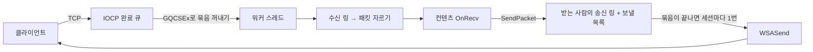

# Windows IOCP 네트워크 라이브러리

> **최적화가 처리량을 61% 떨어뜨린 원인을 측정으로 추적해, 우연에 기대던 송신 구조를 설계로 고친 C++ 서버 네트워크 라이브러리입니다.**

게임 서버 개발을 목표로, IOCP와 `AcceptEx` 기반 TCP 서버 라이브러리를 DLL로 만들고 그 위에 에코·채팅 서버와 검증·부하 클라이언트를 직접 구현했습니다. 방 브로드캐스트처럼 메시지가 몰리는 상황을 채팅 서버로 시험하며, 빠르게 만드는 것만큼 **숫자가 왜 그렇게 나왔는지 설명하는 것**을 목표로 삼았습니다.

C++ · Windows · IOCP · Winsock2 · Visual Studio 2022

## 핵심 성과

| 무엇을                  | 결과                                        |
| ----------------------- | ------------------------------------------- |
| 처리량 −61%의 원인 추적 | 대조 조건으로 분리, 우연한 모아 보내기 발견 |
| 모아 보내기를 설계로    | 에코 처리량 +57–58%                         |
| 브로드캐스트로 확장     | 방 16 전달 처리량 12.7–12.9배               |
| 잘못된 기본값 발견      | 채팅 전달 2.6배, 최대 지연 68 → 15ms        |
| 고부하 합격 시험        | 서버 CPU 1.86/2에서 정상 클라 끊김 0        |
| 데드락 경로 제거        | 강제 실패로 재현, 원인 확인 후 제거         |
| 연결 수락 방식 결정     | 같은 용량에서 `accept`의 1.24배, 실패율 1/6 |

**모아 보내기**는 여러 메시지를 `WSASend` 한 번에 실어 보내는 것입니다.

> **수치를 읽을 때:** 서버와 클라이언트를 같은 PC에서 돌린 루프백 측정이며, 크기보다 방향이 중요합니다. 2026-11-05 이전 측정은 서버가 최적화 없는 `/Od` 빌드였음을 뒤늦게 발견해, 송신 경로 수치를 옛 커밋까지 `/O2`로 다시 빌드해 전부 다시 쟀습니다(Core i5-8600, 조건별 3회 중앙값, [원본과 표](실험폴더/portfolio_o2_2026_11_05/결과.md)). 연결 수락 수치는 지금은 쓰지 않는 실험용 서버로 잰 당시 값입니다.

## 구조



- **스레드:** 로직 스레드 없이 워커가 콜백을 직접 실행합니다. 수락도 `AcceptEx`로 워커가 처리합니다.
- **세션:** 시작할 때 만들어 재사용하고, 수명은 I/O 카운트 하나로 관리합니다. 해제는 항상 워커에서 합니다.
- **비용:** 워커 시간의 약 60%가 `WSASend`, 컨텐츠를 포함한 `OnRecv` 전체가 약 30%입니다(하이브리드 CPU 노트북에서 잰 임시 값, 비율만 참고).

컨텐츠는 라이브러리를 상속해 콜백만 구현합니다.

```cpp
class EchoServer final : public NetworkLib
{
protected:
	void OnRecv(const uint64_t id, const char* payload, const int32_t len) override
	{
		SendPacket(id, payload, len); // 링에 넣기만 하고, 라이브러리가 묶음 끝에 모아 보낸다
	}
	// OnAccept, OnRelease 생략
};
```

상세: [라이브러리 구조](portfolio/architecture.md) · [문서 안내](portfolio/README.md)

## 대표 사례

**1. 최적화가 처리량을 61% 떨어뜨린 이유 찾기**

완료 통지를 줄이려고 skip(`FILE_SKIP_COMPLETION_PORT_ON_SUCCESS`)을 켜자 `WSASend` 호출이 8배로 늘어 처리량이 77.9만 → 30.2만 패킷/s가 됐습니다. 패킷마다 원래 `WSASend`를 1번 부르는 4KB 대조 조건은 차이가 없어, 원인이 완료 통지가 아니라 **그때까지 우연히 일어나던 모아 보내기가 사라진 것**임을 분리했습니다. 수신 처리 끝에서 한 번만 보내도록 설계해 에코 처리량이 57–58% 올랐습니다. → [송신 경로](portfolio/cases/send_path.md)

**2. 브로드캐스트에서 같은 문제를 다시 찾기**

앞의 수정은 응답만 모았기 때문에, 다른 세션에게 보내는 채팅에서는 메시지마다 `WSASend`를 불렀습니다. 받는 사람마다 모으도록 넓혀 방 16 전달 처리량이 12.7–12.9배가 됐습니다. 그 뒤 보내는 시점을 "꺼낸 완료 묶음의 끝"으로 바꿔 397만 → 1013만/s, 최대 지연 33–68ms → 14–15ms가 됐습니다. → [브로드캐스트](portfolio/cases/broadcast.md)

**3. 코드를 읽다 찾은 데드락 경로 재현하고 없애기**

해제 작업 전달이 실패하는 드문 분기에서, 방 락을 쥔 스레드가 `OnRelease`로 같은 락을 다시 잡는 경로를 찾았습니다. 실패를 강제해 재현하고(20회 중 4회 서버 종료), 예외로 원인을 확인했습니다. 복구할 방법이 없는 실패라 그 자리 해제를 없애고 로그를 남긴 뒤 멈추도록 고쳤습니다. 실제 운영에서 일어난 적은 없고, 실패 조건과 빈도는 모릅니다. → [데드락 경로](portfolio/cases/deadlock.md)

**4. 공정한 조건으로 연결 수락 방식 정하기**

처음 비교에서 나온 `AcceptEx`의 우위는 방식이 아니라 수용 용량 차이(1200 대 200)였습니다. 용량을 맞추자 워커 1개에서는 `accept`보다 실패율이 약 9배 높았고, 워커 2개부터 역전됐습니다. 그래서 `AcceptEx` + 워커 2개로 정했습니다. → [연결 수락](portfolio/cases/accept.md)

## 검증 방법

- **바이트 단위 에코 검증:** 무작위로 잘라 보낸 패킷 스트림을 모두 비교합니다.
- **방 순번 검사:** 일부러 넣은 버그가 잡히는 것까지 확인했습니다.
- **섞인 클라이언트 합격 시험:** 서버 CPU 1.86/2에서 문제 클라이언트 4종이 각자 맞는 이유로 끊기는 동안, 정상 채팅 256세션과 하트비트 64세션의 끊김은 0이었습니다.
- **측정 자체를 의심:** 클라이언트 한계, 프로파일러 비용, `/Od` 빌드 등 측정 실수를 찾아 결론까지 고쳤습니다.

상세: [검증과 측정 방법](portfolio/verification/README.md) · [에러와 해석 실수 기록](README_ERRORS.md)

## 한계와 다음 단계

**한계**
- 모두 루프백 측정이라 CPU와 커널 TCP 스택을 서버·클라이언트가 나눠 씁니다. 서버 단독 한계는 재지 못했습니다.
- 부하가 closed-loop라 포화 전 지연은 재지 못했습니다.
- **정상 클라이언트 넘침 끊김이 남아 있습니다.** 방을 계속 옮기는 부하(워커 4)에서 15초에 수십 건 납니다. 기본값인 워커 2의 섞인 클라이언트 시험에서는 0건입니다.
- 한 PC에서는 채팅 처리량이 워커 2에서 가장 높고 워커를 늘리면 떨어집니다(993만 → 워커 4 846만/s). 다른 PC에서는 반대라 원인을 확정하지 못했습니다.
- 즉시 완료 반복 중 송신이 묶음 끝까지 밀리는 문제를 알고 있으며, 지금은 고치지 않기로 했습니다.
- 실제 게임 로직과 암호화는 아직 없습니다.

**다음 단계**
1. `WSASend` 비용을 중심으로 한 성능 개선 하나를 사례로 정리
2. 방 인원 상한 등 컨텐츠 제약으로 넘침 보완
3. 세션별 키 암호화

## 빌드와 실행

Windows, Visual Studio 2022(MSVC), x64가 필요합니다.

```powershell
$msbuild = "C:\Program Files\Microsoft Visual Studio\2022\Community\MSBuild\Current\Bin\MSBuild.exe"
& $msbuild networkLibProject\networkLibProject.sln /p:Configuration=Release /p:Platform=x64 /m /v:minimal /nologo
& $msbuild EchoClient\EchoClient.sln /p:Configuration=Release /p:Platform=x64 /m /v:minimal /nologo
& $msbuild LoadClient\LoadClient.sln /p:Configuration=Release /p:Platform=x64 /m /v:minimal /nologo

# 서버 + 에코 클라이언트 → 세션 0 복귀 확인 → 정상 종료 확인
.\tools\echo_test.ps1 -Name demo -RunSec 15

# 섞인 클라이언트 합격 시험
.\tools\mixed_test.ps1 -Rounds 3 -RunSec 25
```

서버는 `networkLibProject/server.cfg`를 읽습니다. `chatRoomCnt`가 0이면 에코, 1 이상이면 채팅 서버로 동작합니다.

| 경로                 | 내용                                   |
| -------------------- | -------------------------------------- |
| `_lib/NetworkLib/`   | 라이브러리 DLL                         |
| `_lib/ProtocolLib/`  | 서버·클라이언트 공용 패킷 헤더         |
| `networkLibProject/` | 서버 exe - 에코·채팅 컨텐츠, 설정 읽기 |
| `EchoClient/`        | 정확성 검증 클라이언트                 |
| `LoadClient/`        | 처리량 측정·시험용 부하 클라이언트     |
| `tools/`             | 자동 시험·측정 스크립트                |
| `portfolio/`         | 구조, 사례, 검증, 설계 기록            |
