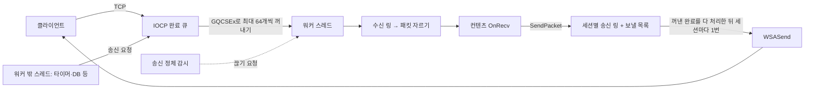

# Windows IOCP 네트워크 라이브러리

> **게임 서버용 TCP 네트워크 라이브러리를 C++로 직접 설계했습니다. 주요 설계 결정마다 왜 그렇게 정했는지, 어떤 안을 버렸는지, 그 판단이 맞는지 어떻게 확인했는지를 함께 남겼습니다.**

IOCP와 `AcceptEx` 기반의 서버 라이브러리를 DLL로 만들고, 그 위에 에코 서버·시험 클라이언트와 로그인 서버 + 게임 서버(인증 분산, 암호화 채널, MySQL, Redis, 운영 툴), 그 상태를 1초마다 모아 DB에 남기는 모니터링 서버와 GUI 클라를 구현했습니다. 방 브로드캐스트처럼 메시지가 몰리는 상황에서 "빠르다"보다 **숫자가 왜 그렇게 나왔는지 설명할 수 있는 설계**를 목표로 삼았습니다.

C++ · Windows IOCP · MySQL · Redis · Windows CNG(RSA·AES-GCM) · Argon2id · Dear ImGui

**주요 결과**(괄호 안은 근거가 있는 절)

- 송신을 "꺼낸 완료를 다 처리한 뒤" 세션마다 한 번 보내도록 바꿔, 방 16 채팅의 전달 처리량 2.4배, 메시지 왕복 지연 p99 20.7 → 7.6ms([송신 시점](#설계-결정), PC B)
- 해제 작업 넣기가 실패한 분기에서 방 락을 다시 잡는 경로를 실패를 강제해 재현하고(20회 중 4회 서버 종료) 없앰([세션 수명](#가장-오래-고민한-것))
- 로그인 서버로 인증을 나눠, 게임 서버가 인증까지 하는 구조와 비교해 입장 폭주 60초 동안 게임 서버 CPU 1.57 → 0.02코어, 이미 들어온 사람의 가장 늦은 채팅 약 4초 → 91ms([인증 분산](#사용-예-로그인-서버--게임-서버--모니터링-서버), 두 PC)
- 봇 30개 1시간 시험에서 입장 1,771번 중 6번 일어나는 순서 버그를 찾아 고치고, 다시 1시간 오류 0

## 구조



- **스레드:** 워커가 완료와 컨텐츠 콜백을 직접 처리합니다. 컨텐츠가 만든 다른 스레드(타이머, DB 스레드)도 `SendPacket`을 부를 수 있지만, 실제 `WSASend`와 세션 해제는 IOCP를 거쳐 항상 워커가 합니다. 한 프로세스에 라이브러리 객체가 여럿이어도(게임 서버 + 운영자 서버) 다른 객체의 워커는 워커 밖 스레드로 취급합니다.
- **세션:** 시작할 때 최대 수만큼 만들어 재사용하고, 컨텐츠는 포인터가 아니라 ID로만 다룹니다. 수명은 I/O 카운트 하나로 관리합니다.
- **컨텐츠 경계:** 컨텐츠는 라이브러리를 상속해 `OnAccept`, `OnRecv`, `OnRelease`를 구현합니다. 워커 밖 스레드(DB 등)가 세션을 쓰는 동안에는 `HoldSession`/`UnholdSession`으로 해제를 막을 수 있고, DB 처리 자체는 컨텐츠가 맡습니다. 방 정책이나 게임 규칙은 라이브러리가 모릅니다.

상세: [라이브러리 구조](portfolio/architecture.md)

## 설계 결정

| 영역        | 선택               | 버린 안          | 이유                 |
| ----------- | ------------------ | ---------------- | -------------------- |
| 연결 수락   | `AcceptEx`         | `accept`         | 워커 2개↑ 실패 1/6   |
| 완료 꺼내기 | GQCSEx 64개씩      | GQCS             | 꺼낸 만큼 모아 보냄  |
| 워커 수     | 동시 실행 수 따로  | 코어 수만큼 깨움 | 깨면 덜 모음         |
| 컨텐츠 실행 | 워커가 바로 처리   | 큐 + 로직 스레드 | 큐 경합·복사 없음    |
| 세션 수명   | 카운트 + 해제 비트 | 세션 락          | 송신마다 락 없음     |
| 송신 버퍼   | 세션별 링 32KB     | 직렬화 버퍼 공유 | 컨텐츠 세션별 암호화 |
| 송신 시점   | 꺼낸 완료 후 1번   | 수신 1건마다     | 방 전달 2.4배        |
| 무응답 클라 | 시간 기준 판정     | TCP에 맡김       | 수신 윈도우 0        |
| 배포        | DLL + 헤더 분리    | 정적 라이브러리  | 세 서버가 DLL 공유   |

- **연결 수락:** 연결이 몰릴 때 `AcceptEx`는 워커 2개에서 거절 비율 0.006%로 `accept` 전담 스레드(0.038%)의 1/6, 처리량은 1.24배였습니다. 워커 1개에서는 오히려 거절이 9배 많았는데, 미리 걸어 둔 소켓이 모자라 백로그를 거친 연결을 워커가 기다렸기 때문입니다(PC A, 5분 측정). → [연결 수락](portfolio/cases/accept.md)
- **세션 수명:** 해제를 정확히 한 번 하는 것은 세션 락으로도 할 수 있지만, 그러려면 송신·세션 찾기마다 락을 잡아야 하고 "아무도 안 쓰는 순간"은 결국 카운트로 알아야 합니다. 그래서 카운트 하나에 해제 표시 비트를 넣어 락 없이 처리합니다.
- **배포:** 서버는 공개 헤더만 보고 세션 구조는 DLL 안에 둡니다. 함수 안쪽만 바뀌면 DLL만 바꿔도 되지만, 서버와 DLL은 같은 커밋으로 함께 빌드하는 것을 원칙으로 합니다. 같은 PC의 로그인·게임·모니터 서버가 DLL 코드 페이지를 공유합니다.
- **워커 수:** 처리량은 워커 수가 아니라 IOCP 동시 실행 수가 정합니다. 동시에 깨어 있는 워커가 많으면 한 번에 꺼내는 완료가 줄어 덜 모아 보내기 때문입니다(워커 4: 884만 → 동시 실행 수 2로 묶자 1048만/s).
- **컨텐츠 실행 스레드의 대가:** 서로 다른 세션의 콜백이 여러 워커에서 동시에 불리므로 공유 데이터는 컨텐츠가 락으로 보호합니다. 같은 세션의 `OnRecv`는 순서대로 불리고 동시에 불리지 않습니다.
- **송신 버퍼:** 라이브러리는 받은 바이트를 그대로 전송만 하고, 암호화는 컨텐츠가 세션마다 다른 키로 맡습니다. 그러면 같은 메시지라도 받는 세션마다 보내는 바이트가 달라져, 한 번 직렬화한 버퍼를 여러 세션이 공유할 수 없습니다. 그래서 공유 버퍼 대신 세션마다 고정 크기 송신 링을 두고, 컨텐츠가 세션별로 만든 바이트를 각자의 링에 받는 구조로 설계했습니다.
- **송신 시점:** `SendPacket`은 받는 세션의 송신 링에 쌓기만 하고 `WSASend`는 모아서 부릅니다(send coalescing). `WSASend` 1번 비용(약 7µs)은 실린 메시지 수와 거의 상관없어, 언제 부르느냐가 처리량을 정합니다. 채팅 방 16에서 세 시점을 비교했습니다(PC B, 워커 2, 3회 중앙값).
  - **부하 패턴:** 부하 클라이언트는 256세션(방 16명씩 16개)이 각자 32바이트 메시지 16개를 `send` 한 번으로 보내고, 자기 16개가 방송으로 모두 돌아오면 곧바로 다음 16개를 보냅니다. 속도 제한 없이 서버가 처리하는 만큼 계속 보내는 포화 부하입니다.
  - **메시지마다 → 수신 1건마다:** 메시지 하나를 처리할 때마다 보내던 것을, 수신 버퍼에서 꺼낸 메시지를 다 처리한 뒤 한 번 보내도록 바꿨습니다. `WSASend`당 메시지 1.1 → 16.4개, 전달 30.4만 → 387만/s(12.7배), 방 락을 잡은 시간 94 → 0.91µs.
  - **수신 1건마다 → 꺼낸 완료마다(지금):** 수신 1건에는 보낸 사람 한 명의 메시지만 있어 16개씩만 모였습니다. GQCSEx로 꺼낸 완료(최대 64개)를 다 처리한 뒤로 넓히자 59개, 411만 → 993만/s(2.4배), 지연 p99 20.7 → 7.6ms. 타이머로 기다리지 않아 한가하면 곧바로 나갑니다.
- 영역마다 하는 일, 고려한 다른 안, 근거, 남은 고민은 [라이브러리 구조](portfolio/architecture.md)에 있습니다.

## 가장 오래 고민한 것

**1. 송신 경로: 우연에 기대던 모아 보내기를 설계로**

완료 통지를 줄이려고 skip(`FILE_SKIP_COMPLETION_PORT_ON_SUCCESS`)을 켜자 처리량이 77.9만 → 30.2만 패킷/s로 61% 떨어졌습니다. 패킷마다 원래 `WSASend`를 1번 부르는 4KB 대조 조건은 차이가 없어, 원인이 완료 통지가 아니라 **송신 완료가 늦게 처리되는 동안 우연히 일어나던 모아 보내기가 사라진 것**임을 분리했습니다. 수신 처리 끝에서 한 번만 보내도록 바꿔 에코 처리량이 57–58% 올랐고, 받는 사람마다 모으도록 넓혀 방 16 전달 처리량이 12.7–12.9배가 됐습니다(위 표의 2.4배는 그다음 단계인 "꺼낸 완료마다"의 몫). → [송신 경로](portfolio/cases/send_path.md) · [브로드캐스트](portfolio/cases/broadcast.md)

**2. 세션 수명: 해제는 정확히 한 번, 그리고 항상 워커에서**

해제는 IOCP에 작업으로 넣어 항상 워커에서 하는데, 넣기(`PostQueuedCompletionStatus`)가 실패한 분기만 그 자리에서 해제했습니다. 이 분기는 방 락을 쥔 채 `OnRelease`가 같은 락을 다시 잡는 경로였습니다. 실패를 강제해 재현했고(20회 중 4회 서버 종료), 복구할 방법이 없는 실패라 그 자리 해제를 없애고 로그를 남긴 뒤 멈추도록 바꿨습니다. 그 뒤 카운트의 63번 비트를 해제 표시로 써서 잠금 없이 해제를 한 번만 일어나게 했고, 리뷰에서 네 판이 실행 순서 시나리오로 깨진 끝에 "표시는 수락에서 새 ID를 쓴 뒤에만 지운다"는 결론을 얻었습니다. → [데드락 경로](portfolio/cases/deadlock.md) · [세션 수명](portfolio/cases/session_lifetime.md)

**3. 무응답 클라: 정상 클라를 잘못 끊지 않는 판정**

상대의 수신 윈도우가 0이면(zero window) TCP는 연결을 끊지 않습니다. 그래서 라이브러리는 `WSASend`를 건 뒤 기준 시간 넘게 끝나지 않은 연결을 송신 정체로 끊고(설정 `sendStallSec`, 세 서버 모두 10초), 아무것도 보내지 않는 연결을 끊는 수신 타임아웃은 메시지의 뜻을 아는 컨텐츠 몫으로 나눴습니다(로그인 서버 요청 기한 10초, 게임 서버 입장 기한 60초). 어려웠던 것은 끊는 것보다 **잘못 끊지 않는 것**이었습니다. 앞서 만든 채팅 서버에서 부호 없는 시각 뺄셈이 활발한 세션을 끊었고, 서버가 밀린 동안 하트비트를 보내던 클라가 끊겼고, 워커에 맡긴 송신의 큐 대기를 송신 정체로 세기도 했습니다. 시각 뺄셈과 큐 대기 오판은 재현한 뒤 고쳤고, 하트비트 클라가 끊긴 문제는 송신을 모으는 범위의 기본값을 바꾼 뒤 사라졌습니다(원인은 확정하지 못함). 그 뒤 서버 CPU가 포화된 상태에서도 정상 클라 끊김 0을 확인했습니다. → [연결 감시](portfolio/design/timeout.md)

**4. 서버 객체가 둘이 되자: "아무 스레드에서나"의 범위**

게임 서버에 운영자 포트를 같은 라이브러리의 두 번째 서버 객체로 붙이려다, 라이브러리가 "이 스레드가 워커인가"를 `static thread_local` 워커 번호 하나로만 판단한다는 것을 찾았습니다. 운영자 서버의 워커가 게임 플레이어에게 `SendPacket`하면 자기를 게임 서버의 워커로 여겨, **게임 세션을 자기 송신 목록에 올리고 게임 서버의 카운터를 자기 번호로 읽습니다.** 워커마다 소속 객체를 함께 기록하고, 다른 객체의 워커는 워커 밖 스레드처럼 워커에게 송신을 맡기도록 고쳤습니다. 객체가 하나일 때는 드러나지 않던 문제라, "`SendPacket`은 아무 스레드에서나"라는 약속에 다른 객체의 워커도 들어간다고 범위를 다시 적었습니다. → [에러 기록 2-13](README_ERRORS.md)

## 검증

에코 서버와 시험 클라이언트로 라이브러리가 깨질 수 있는 지점을 하나씩 시험했습니다. 아래 케이스는 모두 마지막 코드로 확인했습니다(PC A, 2026-11-22). 시험마다 세션이 0으로 돌아오고 서버가 정상 종료하는 것을 함께 봅니다.

| 테스트 케이스                 | 결과(PC A)                                              |
| ----------------------------- | ------------------------------------------------------- |
| 회신 메시지의 순서·내용       | 640세션·15초, 묶음 10,393개 - 불일치 0, 예상 밖 끊김 0  |
| 송신을 멈춘 뒤 오지 않는 회신 | 47번 멈춰 모두 2초 안에 못 받은 회신 0                  |
| 비정상 길이 헤더 차단         | 보낸 768개 모두 즉시 끊김                               |
| 송신 정체 연결 끊기           | 192개 모두 4.5–5.5초에 끊김(기준 3초, 서버 송신 버퍼 0) |
| FIN·RST별 세션 해제           | 수락 1,447 = 해제 1,447(클라 FIN 640·RST 195 포함)      |
| 서버 종료 시 정리             | 매번 세션 0, 종료 완료                                  |

- **순서·내용:** 서버는 여러 응답을 모아 `WSASend` 한 번으로 보냅니다. 모으는 과정에서 순서가 바뀌거나 내용이 섞이지 않는지, 세션이 5–10초마다 다시 접속하며 봅니다.
- **멈춘 뒤 회신:** 세션마다 송신 플래그로 `WSASend`를 하나씩만 겁니다. 플래그를 잘못 다루면 링에 데이터가 남아 있는데도 아무도 `WSASend`를 걸지 않으므로, 요청을 멈추고 기다려 봅니다.
- **비정상 헤더:** 길이가 최대보다 큰 헤더가 오면 그 데이터를 기다리지 않고 즉시 끊어야 합니다.
- **송신 정체:** 상대가 읽지 않아 수신 윈도우가 0이 되어도 TCP는 끊지 않으므로, 라이브러리가 시간 기준으로 끊는지 봅니다.
- **FIN·RST:** 끊김은 FIN이면 0바이트 수신 완료로, RST면 실패한 완료 또는 I/O를 걸 때의 즉시 실패로 옵니다. 경로마다 I/O 카운트를 정확히 내려야 합니다 - 놓치면 세션 슬롯이 돌아오지 않고, 두 번 내리면 사용 중인 세션이 해제됩니다.

- 측정 자체도 의심했습니다. 클라이언트가 먼저 포화된 숫자, 프로파일러 비용이 한쪽에만 붙은 비교, 최적화가 꺼진 `/Od` 빌드를 찾아 결론까지 고쳤습니다. → [에러와 해석 실수 기록](README_ERRORS.md)

## 사용 예: 로그인 서버 + 게임 서버 + 모니터링 서버

이 라이브러리로 로그인 서버와 게임 서버를 따로 띄우고, 둘이 직접 연결하지 않고 Redis로 인증을 넘기는 구조를 만들었습니다. 게임 서버의 컨텐츠는 채팅방 하나이고, 입장·암호화·DB를 시험으로 먼저 다지는 데 집중했습니다. **에코로는 시험할 수 없던 라이브러리 기능을 실제 서버에서 썼습니다.**

- **인증 분산:** 비밀번호는 로그인 서버만 다룹니다(Argon2id + 솔트 + 페퍼). 로그인하면 일회용 세션 키를 Redis에 30초 넣고, 게임 서버는 그 키로 잠근 입장 요청을 풀어 확인한 뒤 키를 지웁니다(같은 키로 두 연결이 와도 하나만). 입장 요청에는 게임 서버가 연결마다 준 무작위 시작 번호(SeqNumber)가 들어가, 가로챈 요청을 다른 연결에서 다시 쓰지 못합니다.
- **암호화 채널:** 로그인 구간은 RSA 2048(Windows CNG)만 씁니다 - 접속마다 임시 키로 잠그고 클라에 박아 둔 서버 고정 키는 서명만 하므로, 고정 키가 새도 녹화해 둔 로그인 패킷은 풀리지 않습니다. 그 뒤 게임 구간은 세션 키로 AES-256-GCM을 씁니다. RSA 에코를 재 보니 요청 시간의 96%가 비밀 키 연산이었고, 같은 조건의 AES 에코는 메시지 하나가 약 1,000배 빨랐습니다.
- **워커 밖 스레드와 세션 붙잡기:** 입장 확인은 Redis·MySQL을 기다리므로 워커가 `HoldSession` 뒤 DB 스레드에 넘기고 바로 돌아갑니다. DB 스레드가 입장 응답을 `SendPacket`하고 `UnholdSession`을 부르므로, 그사이 끊겨도 `OnRelease`는 그 뒤에 옵니다.
- **방송과 순서:** 방 락 안에서 구성원 모두의 송신 링에 넣어 받는 사람 모두 같은 순서로 받습니다. 입장 뒤 암호문을 보내는 곳(DB 스레드의 입장 응답, 워커의 채팅 방송)은 모두 방 락 안이라 방 락이 순서를 정하고, 송신 하나하나도 세션 송신 락 안에서 번호를 매기고 암호화해 방 밖에서 보내는 기능이 생겨도 순서가 깨지지 않게 했습니다.
- **서버 객체 두 개:** 게임 서버 프로세스에 운영자 포트(127.0.0.1, 운영자 키, 5초 인증 기한)를 같은 라이브러리의 두 번째 객체로 띄웁니다(위 4번). 운영 툴로 계정 차단·해제를 합니다.
- **1시간 시험이 찾은 순서 버그:** 1시간 시험(봇 30개, PC A)에서 입장 1,771번 중 6번 봇이 자기 첫 채팅을 돌려받지 못했습니다. 입장 응답을 보낸 뒤 방에 넣어, 응답을 받자마자 보낸 채팅이 그 틈에 처리된 것이었습니다. 응답과 방 넣기를 방 락 안에서 한 번에 하도록 고친 뒤 다시 1시간 돌려 입장 1,770번·채팅 6만 개에 오류 0, 두 서버 메모리 증가 없음을 확인했습니다.
- **인증을 나눈 효과:** 같은 입장 폭주(입장하자마자 끊고 다시 들어오는 봇 100개, 60초)를 지금 구조와, 게임 서버가 로그인 서버와 같은 인증(RSA + Argon2id 64MiB)까지 하도록 흉내 낸 구조에 넣었습니다. 게임 서버만 PC B에 두고 나머지는 PC A에 둔 두 PC 측정에서 게임 서버 CPU 0.017 대 1.56–1.58코어, 메모리 53.6 대 182.5MB, 이미 들어온 채팅 봇의 가장 늦은 채팅 86–91ms 대 3.8–4.4초였습니다. 한 PC 측정과 같은 크기라, 차이는 CPU 경쟁이 아니라 게임 서버가 떠안은 인증 몫입니다(봇 쪽 PC는 무선 - 절대값보다 차이를 봅니다).
- **모니터링 서버:** 같은 라이브러리 위 세 번째 서버입니다. 로그인·게임 서버가 1초마다 누적치(CPU 시간·메모리·핸들, 수락·송수신, 끊은 이유별 수 등)를 보내면, 모니터가 단조 시각으로 1초 값을 계산해 GUI 클라(Dear ImGui + ImPlot)에 보내고, 60초마다 1초 행과 1분 요약을 트랜잭션 하나로 MySQL에 남깁니다. 표본이 3초 넘게 없으면 "응답 없음" 이벤트를 남깁니다. 봇 30개를 2시간 33분 돌리는 동안 서버마다 1초 행 약 9,100개(99%)를 남겼고 저장 실패는 0이었습니다(PC A).

- **시험:** 정상 경로, 입장 비정상 26개(가짜·가로챈·순서 어긋난 패킷), 로그인·채팅·재시작·DB 재연결·운영 툴, 두 서버 경계(장애·기한·대기열 상한), 접속 폭주를 시험 스크립트 10개·판정 142개로 판정합니다([테스트 케이스](portfolio/verification/game_test_cases.md)). 시험마다 계정을 직접 만들어 몇 번이든 다시 돌릴 수 있습니다.

상세: [게임 서버 구조](portfolio/game_architecture.md) · [로그인 서버 구조](portfolio/로그인서버_구조.docx) · [봇 부하 시험 기록](portfolio/verification/game_soak.md) · [처리 흐름(클라 한 명의 순서, 단계마다 스레드·락)](portfolio/design/게임서버_클라_흐름.docx) · [모니터링 서버 설계](portfolio/design/모니터링서버_설계.docx) · [인증 분산 측정](실험폴더/auth_offload_2026_11_21/two_pc/결과.md)

## 선택의 대가: 얻은 것과 잃은 것

설계마다 얻은 것과 내준 것입니다.

| 결정            | 얻은 것                   | 잃은 것 → 줄이는 방법         |
| --------------- | ------------------------- | ----------------------------- |
| 콜백을 워커에서 | 큐·복사 없음              | 블록 시 워커 막힘 → DB 스레드 |
| 세션별 송신 링  | 세션별 암호화·순서        | 몰리면 끊김 → 방 인원 상한    |
| 워커가 해시까지 | 해시를 워커 수만큼 동시에 | MySQL 멈추면 막힘 → 빠른 실패 |
| 키 256개 미리   | 폭주 중 로그인 성공       | 동시 연결 상한 → 주소별 제한  |
| 키 하나 2연결   | 키 만들기 절반            | 리플레이 여지 → 1회·서버 난수 |

## 빌드와 실행

Windows, Visual Studio 2022(MSVC), x64가 필요합니다.

```powershell
$msbuild = "C:\Program Files\Microsoft Visual Studio\2022\Community\MSBuild\Current\Bin\MSBuild.exe"
& $msbuild Echo\Echo.sln /p:Configuration=Release /p:Platform=x64 /m /v:minimal /nologo
```

- 서버(`Echo\x64\Release\EchoServer.exe`)는 `Echo/Server`에서 실행해 `server.cfg`를 읽습니다. Q로 종료합니다.
- 시험 클라이언트(`EchoClient.exe`)는 `Echo/Client`에서 실행해 `client.cfg`의 역할별 세션 수(`normalCnt`, `badHeaderCnt`, `sendStallCnt`)대로 접속합니다. S로 일시정지·다시 시작, Q로 종료하며 마지막 줄에 `[result] PASS/FAIL`을 출력합니다.
- 테스트 케이스를 자동으로 다시 돌리는 명령은 [테스트 케이스](portfolio/verification/test_cases.md#다시-돌리기)에 있습니다.

게임 서버는 MySQL(8.0 이상), Redis(세션 키), libsodium 1.0.22 MSVC판(환경 변수 `SODIUM_DIR`)이 필요합니다.

```powershell
& $msbuild Game\Game.sln /p:Configuration=Release /p:Platform=x64 /m /v:minimal /nologo
```

- `Game/Server/db.cfg.example`을 `db.cfg`로 복사해 DB 접속 정보와 운영자 키를 채운 뒤 빌드합니다(`db.cfg`는 저장소에 올리지 않습니다). 테이블은 처음 실행할 때 만들어집니다. 던전·경매가 있던 옛 `accounts` 표(gold 열)가 남아 있으면 게임 서버가 시작을 거부하니 옮기거나 지웁니다.
- `Game/Server/db.cfg`에 Redis 주소·비밀번호도 채웁니다. 로그인 서버는 `Game/Login/login.cfg.example`을 `login.cfg`로 복사하고 페퍼를 채운 뒤, `LoginServer.exe --genkey`로 RSA 서명 키를 만들어 비밀 키는 `login.cfg`에, 공개 키는 `Game/Login/server_public.cfg`에 넣습니다(클라 빌드 때 복사됩니다).
- `Game\x64\Release`에서 `LoginServer.exe`(포트 33002), `GameServer.exe`(포트 33000, 운영자 포트 127.0.0.1:33001), `GameClient.exe`(콘솔 게임 클라이언트, `register`·`login` 뒤 `help`로 명령), `GameBot.exe`(부하 시험 봇), `AdminTool.exe`(운영 툴), `MonitorServer.exe`(포트 33010, `Game/Monitor`에서 실행해 `monitor.cfg`를 읽음), `MonitorClient.exe`(모니터 GUI)를 실행합니다.

| 경로                          | 내용                                                |
| ----------------------------- | --------------------------------------------------- |
| `_lib/NetworkLib/`            | 라이브러리 DLL                                      |
| `_lib/ProtocolLib/`           | 서버·클라이언트 공용 패킷 헤더                      |
| `Echo/Server/`                | 에코 서버                                           |
| `Echo/Client/`                | 에코 시험 클라이언트(select 스레드 1개)             |
| `Game/Server/`                | 게임 서버(입장 확인, 채팅방, 계정 행, 운영자 포트)  |
| `Game/Login/`                 | 로그인 서버(가입·로그인, Argon2id, RSA 키 256개)    |
| `Game/Protocol/`              | 게임 프로토콜, RSA 로그인 채널, AES-GCM 게임 채널   |
| `Game/Client/`, `Game/Admin/` | 게임 콘솔 클라이언트, 운영 툴                       |
| `Game/Bot/`                   | 부하 시험 봇(입장·채팅·재접속 반복)                 |
| `Game/Monitor/`               | 모니터링 서버(1초 값 계산, 60초마다 MySQL 저장)     |
| `Game/MonitorClient/`         | 모니터 GUI 클라이언트(Dear ImGui + ImPlot)          |
| `tools/`                      | 에코·게임 자동 시험, 덤프 요약, 문서·코딩 규칙 검사 |
| `portfolio/`                  | 구조, 사례, 검증, 설계 기록                         |
