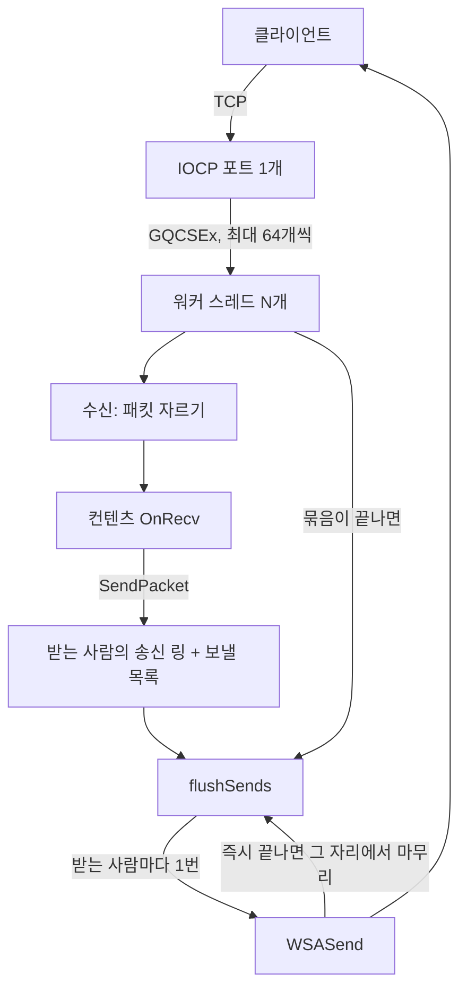

# 라이브러리 구조

**IOCP 포트 하나에 모든 소켓을 묶고, 워커 스레드가 완료를 묶음으로 꺼내 처리한 뒤, 묶음 끝에서 받는 사람마다 `WSASend`를 한 번씩 부르는 구조다.** 기본 상태에서 일하는 시간의 약 56%가 `WSASend`이고, 그 몫은 `WSASend` 한 번에 메시지를 얼마나 모으는지로 정해진다.

- 기준 코드: 2026-11-22, `_lib/NetworkLib/`. 사용 예는 `Echo/`(에코 서버·시험 클라)와 `Game/`(로그인 서버·게임 서버 - [게임 서버 구조](game_architecture.md))
- 비용 숫자는 2026-11-09 코드에서 쟀다. 그 뒤 바뀐 것(`HoldSession`, 객체가 둘일 때 워커 구분, `IsDisconnecting`, 리슨 주소 설정)은 수신·송신 경로를 바꾸지 않는다. 조건은 [7장](#7-비용-메시지-1건-전달에-쓰는-시간)에 적었다.

## 1. 전체 그림



- **컨텐츠 처리:** 로직 스레드 없이 워커가 `OnRecv`를 직접 실행한다.
- **컨텐츠 경계:** 컨텐츠는 `NetworkLib`를 상속해 콜백만 구현하고, 세션은 포인터가 아니라 ID로만 다룬다. 게임 규칙이나 방 정책은 라이브러리가 모른다.
- **배포 형태:** 라이브러리는 `NetworkLib.dll`이고, 내보내는 함수는 `NetworkLib.def`로 정한다.

## 2. 스레드

| 스레드         | 개수   | 하는 일                               |
| -------------- | ------ | ------------------------------------- |
| 워커           | 설정값 | 모든 완료 처리, 콜백, 송신, 해제      |
| 송신 정체 감시 | 0–1    | 1초마다 오래 안 끝난 송신을 끊기 요청 |

- 감시 스레드는 끊기를 **요청만** 한다. 실제 해제는 항상 워커가 한다.
- 수락도 전용 스레드 없이 `AcceptEx`로 걸어 두고 워커가 완료를 처리한다.
- 컨텐츠가 만든 스레드(게임 서버의 DB 스레드·입장 기한 감시, 로그인 서버의 요청 기한 감시 등)는 라이브러리에게 **워커 밖 스레드**다. `SendPacket`·`Disconnect`는 부를 수 있지만 `WSASend`와 해제는 워커에게 맡긴다(5장, 3장 끝). 무응답·하트비트 판정은 컨텐츠 몫이다.
- 워커는 IOCP 동시 실행 수(`iocpConcurrency`, 0이면 코어 수)만큼 동시에 깨어난다. 처리량은 워커 수가 아니라 이 값이 정한다([워커 수](design/worker_scaling.md)).

## 3. 세션

세션은 시작할 때 최대 수만큼 만들어 재사용한다. 실행 중에 세션을 할당하지 않는다.

| 멤버            | 역할                                       |
| --------------- | ------------------------------------------ |
| `mID`           | 세대 + 슬롯 번호, 슬롯 재사용 시 ABA 방지  |
| `mIoCount`      | 세션을 쓰는 몫의 수, 63번 비트는 해제 표시 |
| `mRecvBuf` 16KB | 받은 바이트, 수신은 1건이라 락 없음        |
| `mSendBuf` 32KB | 보낼 바이트, 가득 차면 연결을 끊음         |
| `mSendLock`     | 송신 링과 `mbSendFlag` 보호                |
| `mbSendFlag`    | 세션당 `WSASend`는 1건만                   |
| `mbSendTarget`  | 어느 워커의 보낼 목록에 올라 있는가        |
| `mbDisconnect`  | 끊는 중이면 새 I/O를 걸지 않음             |
| `mHoldCnt`      | `HoldSession` 짝 확인용(오용이면 멈춤)     |

**수명은 `mIoCount` 하나로 관리한다.** 다음 경우에 카운트를 잡는다.

- 걸려 있는 수신·송신마다
- 보낼 목록에 올라 있는 동안
- 컨텐츠가 ID로 세션을 찾아 쓰는 동안(`findSession`)
- 수락 처리 중
- 워커 밖 스레드가 `HoldSession`으로 붙잡은 동안(아래)

0이 되면 그 자리에서 해제하지 않고 IOCP에 해제 작업을 넣어 워커가 처리한다. 다른 세션의 `OnRecv` 안에서 0이 될 수 있어, 그 자리에서 해제하면 컨텐츠가 쥔 락을 다시 잡기 때문이다([데드락 사례](cases/deadlock.md)).

**해제는 63번 비트(해제 표시)로 한 번만 일어나게 한다.** 잠금 없이 카운트 하나로 처리한다.

| 단계 | 하는 일                                                        |
| ---- | -------------------------------------------------------------- |
| 해제 | 카운트가 0일 때 CAS로 해제 표시를 세운 한 스레드만 작업을 넣음 |
| 잡기 | `sessionLock`은 +1 한 뒤 표시가 보이면 실패(되돌리지 않음)     |
| 수락 | 새 `mID`를 쓴 뒤 카운트를 1로 덮어써 표시를 지움               |

- 처음 쓰는 슬롯도 해제 표시로 시작한다. 빈 슬롯을 감시 스레드나 `Stop`이 잡지 못한다.
- 실패한 +1을 되돌리지 않는 이유: 되돌린 -1이 0을 만들면 해제가 한 번 더 들어간다. 쌓인 값은 수락 때 1로 덮어써 지운다.
- 표시가 지워진 뒤 들어온 스레드는 새 `mID`를 보므로, 옛 ID로 찾는 `findSession`은 ID 비교에서 걸러진다.

**워커 밖 스레드가 세션을 쓰는 동안: `HoldSession` / `UnholdSession`.** 게임 서버의 입장 확인처럼 블록되는 일(Redis·MySQL)은 워커가 아니라 컨텐츠의 DB 스레드가 한다. 그동안 클라가 끊겨 슬롯이 다른 세션에 재사용되면, DB 스레드가 보낸 결과가 엉뚱한 세션에 가거나 컨텐츠의 세션별 상태가 이미 지워져 있다.

- `HoldSession(id)`: ID를 확인하고 카운트 +1. 실패면 이미 해제됐거나 다른 세션으로 바뀐 ID다.
- 붙잡은 동안 끊겨도 해제(소켓 닫기, `OnRelease`, 슬롯 재사용)는 마지막 `UnholdSession` 뒤로 미뤄진다. 그래서 `OnRelease`는 여전히 그 세션의 마지막 콜백이다.
- 성공한 `HoldSession`마다 `UnholdSession`을 정확히 한 번 - 빠뜨리면 그 세션은 해제되지 않고 `Stop`이 끝나지 않는다. 더 많이 부르면 `mHoldCnt`가 음수가 되어 멈춘다(릴리즈에서도).
- `IsDisconnecting(id)`: 끊기 요청을 받았거나 해제된 세션이면 true. 붙잡은 세션은 끊겨도 해제가 미뤄지므로, 워커 밖 스레드가 비싼 일(해시·DB) 전에 확인해 건너뛸 수 있다.
- 라이브러리에는 DB·작업 큐·결과 처리라는 개념이 없다. 대기열·스레드·순서는 컨텐츠가 맡는다(작업 완료를 IOCP로 넘기던 옛 API는 같은 세션의 완료 순서를 보장하지 못해 지웠다 - [DB 작업 설계](design/db_job.md) 2-10).

## 4. 수신 경로

1. 워커가 수신 완료를 꺼낸다. 소켓을 처음 수락할 때 첫 `WSARecv`를 건다.
2. `WSARecv`는 수신 링의 빈 공간에 직접 받는다.
3. `completeRecv`가 헤더(길이 2바이트)를 읽어 완성된 패킷을 임시 버퍼로 복사하고 `OnRecv`를 부른다.
4. 잘린 패킷은 링에 남아 다음 수신과 이어진다. 비정상 길이면 패킷 경계를 잃은 것이므로 바로 끊는다.
5. 다음 `WSARecv`를 건다.

수신 링(16KB)이 최대 패킷(4098B)보다 커야 함을 `static_assert`로 보장한다. 완성된 패킷을 매번 다 꺼내므로 링이 가득 차는 경우가 없다.

## 5. 송신 경로: 모아 보내기

**`SendPacket`은 소켓에 보내지 않는다.** 받는 사람의 송신 링에 넣고 그 세션을 "보낼 목록"에 올릴 뿐이다.

```text
워커 스레드
 ├ 완료를 최대 64개 꺼냄
 ├ 완료마다
 │   └ OnRecv(A) → 방 락 안에서 구성원마다 SendPacket(B)
 │        ├ findSession: B의 카운트 +1
 │        ├ [mSendLock] B의 링에 헤더 + 페이로드 넣기
 │        └ B를 이 워커의 보낼 목록에 올림 (이미 어느 목록에 있으면 생략)
 └ 묶음 끝 flushSends: 목록의 세션마다
      └ postSend(B)
           ├ [mSendLock] 송신 중이면 끝, 아니면 플래그 켜기
           ├ WSASend (락 밖)
           └ 즉시 끝나면 그 자리에서 마무리하고, 그새 쌓인 것을 이어서 보냄
```

- **왜 이렇게 하나:** `WSASend`는 시스템 콜이라 비싸서(7장 측정에서 1번에 약 7us) 메시지마다 부르면 처리량이 크게 떨어진다. 묶음 끝까지 미루면 여러 보낸 사람의 메시지가 받는 사람마다 한 번에 나간다.
- **타이머가 없다:** 한가하면 꺼낸 완료가 적어 지연 없이 나가고, 바쁘면 많이 합쳐진다.
- **skip:** `FILE_SKIP_COMPLETION_PORT_ON_SUCCESS`를 켜서 즉시 끝난 I/O는 완료 통지 없이 호출한 워커가 처리한다. 즉시 완료가 이어지는 동안에도 그 세션에 쌓인 송신을 먼저 보내고, 연달아 `skipLoopLimit`(기본 3)번째 즉시 완료에서는 다음 차례를 PQCS로 IOCP 큐 뒤에 넣어 한 세션이 워커를 붙잡지 않게 한다(수신은 `RecvContinue`, 2026-11-22 - [설계](design/즉시완료_반복_상한_설계.docx)).
- **락 밖 `WSASend`가 안전한 이유:** `mbSendFlag`가 켜진 동안 다른 스레드는 새 송신을 걸거나 링에서 빼지 못하고, 빈 공간에만 넣는다.
- **순서 보장:** 채팅 방은 방 락 안에서 방 순번을 매기고 전원의 링에 넣는다. 그래서 받는 사람마다 순서가 같다.
- **워커가 아닌 스레드:** `SendPacket`은 아무 스레드에서나 부를 수 있지만 `WSASend`는 워커에서만 한다. 워커가 아니면 링에 넣은 뒤 `mSendLock` 안에서 송신 권리를 잡고 0바이트 송신 완료를 PQCS로 워커에 넘긴다([외부 스레드 송신](design/external_send.md)).
- **"이 객체의 워커인가":** 한 프로세스에 라이브러리 객체가 둘 이상일 수 있다(게임 서버 + 운영자 서버). 워커마다 소속 객체(`tWorkerOwner`)를 기록하고, 다른 객체의 워커는 이 객체에게 워커 밖 스레드로 취급한다([에러 기록 2-13](../README_ERRORS.md)).

## 6. 락과 동시성 규칙

| 락          | 범위     | 보호 대상                     |
| ----------- | -------- | ----------------------------- |
| `mSendLock` | 세션마다 | 송신 링, 송신 플래그          |
| `mFreeLock` | 서버 1개 | 빈 슬롯 스택 (연결·해제 때만) |

라이브러리 락은 둘뿐이고 서로 겹쳐 잡지 않는다. 컨텐츠 락(예: 게임 서버의 방 락) 안에서 `SendPacket`을 부르면 `컨텐츠 락 → mSendLock` 순서가 되고, `WSASend`는 어느 락 안에서도 부르지 않는다. 게임 서버의 락 7개와 순서는 [게임 서버 흐름](design/게임서버_클라_흐름.docx) 0-4, 옛 채팅 서버 기준 전체 목록은 [락 구조](design/lock_logic.md)에 있다.

**구현하며 걸렸던 함정:**

- **`OnRelease` 재진입:** 그 자리에서 해제하면 컨텐츠 락을 다시 잡는다. 항상 워커로 넘기고, 넘기기가 실패하면 로그를 남기고 프로세스를 멈춘다.
- **끊기 경쟁:** `CancelIoEx` 직전에 성공한 수신이 수신을 다시 걸 수 있다. 끊기 플래그로 막고, I/O를 건 **뒤에** 플래그를 다시 확인한다.
- **수락 중 카운트 0:** 첫 수신 전에는 잡은 몫이 없어 `OnAccept` 안의 `Disconnect`가 실패한다. 수락 처리 몫을 먼저 잡는다.
- **해제 표시를 지우는 시점:** 리뷰에서 네 판이 깨졌다. 올린 뒤 1이면 되돌리기(몫 없이 성공), 표시를 지우는 곳 없음(두 번째 연결부터 해제 안 됨), 빈 슬롯 초기값 0(가짜 해제로 빈 슬롯 번호 중복), `allocSession`에서 0 쓰기(수락 준비 중 해제). 표시는 수락 때 새 ID를 쓴 뒤 지워야 한다.
- **0이 되는 경로마다 끊기 플래그:** `WSARecv`가 즉시 실패한 경로만 끊기 플래그를 안 세워, 0이 된 직후 잡은 스레드가 송신을 다시 걸 수 있었다. 그 경로에도 `requestDisconnect`를 넣었다.
- **부호 없는 시각 뺄셈:** 감시 스레드의 `now`보다 워커가 쓴 시각이 나중이면 약 42억이 된다. 시각을 먼저 읽고 `now`를 나중에 읽는다.
- **정상 클라 오판:** 완료 처리가 밀린 것을 클라가 느린 것으로 착각해 끊었다. 지연을 주입하는 시험으로 재현하고 판정을 고쳤다.
- **서버 객체가 둘:** "이 스레드가 워커인가"를 `thread_local` 워커 번호 하나로 판단해, 운영자 서버의 워커가 게임 세션을 자기 송신 목록에 올리고 게임 서버의 카운터를 자기 번호로 읽을 수 있었다. 소속 객체를 함께 기록하도록 고쳤다(5장).
- **워커 밖 스레드가 맡긴 송신의 정체 오판:** 맡길 때 송신 시각을 적어, IOCP 큐 대기를 상대가 안 받는 것으로 셌다. 맡길 때는 판정에서 빼고 워커가 `WSASend` 직전에 적는다([에러 기록 2-12](../README_ERRORS.md)).

전체 기록은 [README_ERRORS.md](../README_ERRORS.md)에 있다.

## 7. 비용: 메시지 1건 전달에 쓰는 시간

**`OnRecv`는 전달 1건에 약 60ns로 거의 일정하고, `WSASend` 몫은 "`WSASend` 1번 비용(약 7us) ÷ 그 1번에 실린 메시지 수"라 크게 바뀐다.** 그래서 처리량은 `WSASend` 한 번에 메시지를 얼마나 모으느냐가 정한다. 기본 상태(워커 2)에서는 일하는 시간의 약 56%가 `WSASend`, 33%가 `OnRecv`다.

| 구간 (ns/전달)      | 워커 2 기본 | 워커 2 많이 모음 | 워커 4    |
| ------------------- | ----------- | ---------------- | --------- |
| `WSASend`           | 104 (56%)   | 37 (33%)         | 235 (72%) |
| `OnRecv` 전체       | 60 (33%)    | 60 (53%)         | 69 (21%)  |
| `WSARecv`           | 9.5 (5%)    | 8.9 (8%)         | 11 (3%)   |
| 완료 처리 나머지    | 4.5 (2%)    | 4.4 (4%)         | 4.9 (1%)  |
| `flushSends` 나머지 | 3.7 (2%)    | 1.1 (1%)         | 7.8 (2%)  |
| GQCSEx 대기         | 1.9 (1%)    | 1.5 (1%)         | 117 (쉼)  |

| 항목               | 워커 2 기본 | 워커 2 많이 모음 | 워커 4 |
| ------------------ | ----------- | ---------------- | ------ |
| 전달/s             | 1090만      | 1768만           | 899만  |
| `WSASend`당 메시지 | 64          | 256              | 30     |
| `WSASend` 1번      | 6.8us       | 9.5us            | 7.0us  |
| 꺼낸 완료          | 22.5        | 64               | 2.6    |
| 서버 코어          | 1.98/2      | 2.04/2           | 2.93/4 |
| 커널 비율          | 59%         | 40%              | 70%    |

- 워커 4의 비율은 쉬는 시간(GQCSEx 대기)을 뺀 일하는 시간 기준이다. 워커 시간 전체로 보면 27%를 일감 없이 기다린다.

**측정 조건**

- PC B(Core i5-8600, 6코어, 하이브리드 아님), 루프백, `/O2`, 2026-11-09 코드
- 채팅 256세션, 방 16, 32B 메시지 16개 묶음, GQCSEx 64 + skip + `mergeSends = 1`
- 프로파일러는 묶음·완료 단위 구간만 잰다(20초 중 5–15초). 워커 2 5회, 워커 4 3회
- 원본: [cost_breakdown_2026_11_09](../실험폴더/cost_breakdown_2026_11_09/). PC A에서 잰 앞선 임시 값(2026-11-06)은 [cost_breakdown_2026_11_06](../실험폴더/cost_breakdown_2026_11_06/)에 남겼다

**읽을 때 주의할 점**

- **워커 2는 회차마다 모으는 양이 다르다.** 같은 조건에서 `WSASend`당 메시지가 64–256으로 갈렸다. 그래서 "기본"과 "많이 모음"을 회차 그대로 나눠 적었다. 중앙값으로 합치면 서로 다른 상태가 섞인다.
- **프로파일러를 켜면 더 많이 모이고 더 빠르다.** 워커 2에서 프로파일러를 끈 5회는 `WSASend`당 56–93개, 1031만–1148만/s, 켠 5회는 64–256개, 1090만–1768만/s였다. 처리가 조금 느려지면 완료가 더 쌓여 한 번에 더 모은다는 뜻이다([README_ERRORS 4-10](../README_ERRORS.md)과 같은 방향). 그래서 끈 실행의 중앙값(64개, 1081만/s)과 상태가 같은 회차를 "기본"으로 골랐다.
- **검산:** `WSASend` 1번 6.8us ÷ 64개 = 106ns, 7.0us ÷ 30개 = 233ns로 표와 맞는다. 회차 안에서 구간 비율을 더하면 99.8–99.9%다.
- **세부 분해 불가:** `SendPacket`마다 측정 코드를 넣으면 처리량이 45–49% 떨어져, 그 안의 카운트 증가·락·복사 비용은 나눌 수 없었다(PC A, 2026-11-06).

**여기서 나오는 판단**

- `OnRecv` 안의 컨텐츠·카운트 증가·락·복사를 전부 없애도 기본 상태에서 줄일 수 있는 시간은 최대 약 33%다.
- 가장 큰 몫은 `WSASend` 호출 횟수다. 워커 4에서는 한 번에 꺼내는 완료가 2.6개라 모을 것이 없어 `WSASend`당 30개뿐이고, 일하는 시간의 72%가 `WSASend`다. 워커를 늘리면 처리량이 줄어드는 이유가 여기서 보인다.
## 8. 주요 설정

서버마다 `server.cfg`(예: `Echo/Server/server.cfg`, `Game/Server/server.cfg`)를 `LoadNetConfig`로 읽어 `NetConfig`로 넘긴다. 기본값은 `NetConfig.h` 한곳에 있고, 아래는 두 서버의 cfg 값이다.

| 키                | 값   | 뜻                                   |
| ----------------- | ---- | ------------------------------------ |
| `workerCnt`       | 2    | 워커 스레드 수                       |
| `iocpConcurrency` | 0    | 동시에 깨어나는 워커 수(0 = 코어 수) |
| `gqcsBatch`       | 64   | 한 번에 꺼내는 완료 수               |
| `skipOnSuccess`   | 1    | 즉시 끝난 I/O는 완료 통지 없음       |
| `mergeSends`      | 1    | 묶음 끝에서 합쳐 보내기              |
| `slotCnt`         | 500  | 걸어 두는 `AcceptEx` 수              |
| `maxSession`      | 1000 | 최대 세션 수                         |
| `sendStallSec`    | 10   | 송신이 이 시간 안 끝나면 끊기        |

- `bLoopbackOnly`(127.0.0.1에만 묶기)는 cfg 키가 아니라 코드에서 정한다 - 게임 서버의 운영자 포트가 쓴다.
