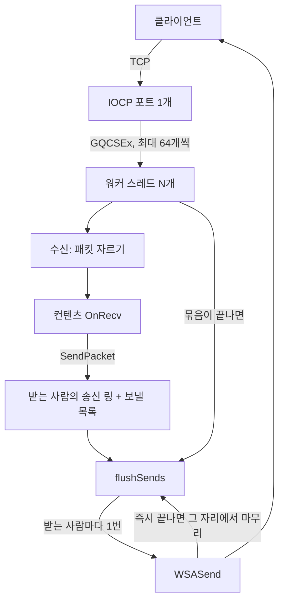

# 라이브러리 구조

**IOCP 포트 하나에 모든 소켓을 묶고, 워커 스레드가 완료를 묶음으로 꺼내 처리한 뒤, 묶음 끝에서 받는 사람마다 `WSASend`를 한 번씩 부르는 구조다.** 워커 시간의 약 60%가 `WSASend`에 쓰이므로, 성능은 유저 코드보다 `WSASend` 한 번에 메시지를 얼마나 모으는지가 좌우한다.

- 기준 코드: 2026-11-06, `_lib/NetworkLib/`, `networkLibProject/`
- 비용 숫자의 조건은 [7장](#7-비용-메시지-1건-전달에-쓰는-시간)에 적었다.

## 1. 전체 그림



- **컨텐츠 처리:** 로직 스레드 없이 워커가 `OnRecv`를 직접 실행한다.
- **컨텐츠 경계:** 컨텐츠는 `NetworkLib`를 상속해 콜백만 구현하고, 세션은 포인터가 아니라 ID로만 다룬다. 게임 규칙이나 방 정책은 라이브러리가 모른다.
- **배포 형태:** 라이브러리는 `NetworkLib.dll`이고, 내보내는 함수는 `NetworkLib.def`로 정한다.

## 2. 스레드

| 스레드           | 개수   | 하는 일                               |
| ---------------- | ------ | ------------------------------------- |
| 워커             | 설정값 | 모든 완료 처리, 콜백, 송신, 해제      |
| 송신 정체 감시   | 0–1    | 1초마다 오래 안 끝난 송신을 끊기 요청 |
| 채팅 무응답 감시 | 0–1    | 1초마다 무응답·미입장 세션 끊기 요청  |
| main, 통계       | 2      | 시작·종료, 1초마다 통계 출력          |

- 감시 스레드는 끊기를 **요청만** 한다. 실제 해제는 항상 워커가 한다.
- 수락도 전용 스레드 없이 `AcceptEx`로 걸어 두고 워커가 완료를 처리한다.

## 3. 세션

세션은 시작할 때 최대 수만큼 만들어 재사용한다. 실행 중에 세션을 할당하지 않는다.

| 멤버            | 역할                                      |
| --------------- | ----------------------------------------- |
| `mID`           | 세대 + 슬롯 번호, 슬롯 재사용 시 ABA 방지 |
| `mIoCount`      | 세션을 쓰는 몫의 수, 0이면 해제           |
| `mRecvBuf` 16KB | 받은 바이트, 수신은 1건이라 락 없음       |
| `mSendBuf` 32KB | 보낼 바이트, 가득 차면 연결을 끊음        |
| `mSendLock`     | 송신 링과 `mbSendFlag` 보호               |
| `mbSendFlag`    | 세션당 `WSASend`는 1건만                  |
| `mbSendTarget`  | 어느 워커의 보낼 목록에 올라 있는가       |
| `mbDisconnect`  | 끊는 중이면 새 I/O를 걸지 않음            |

**수명은 `mIoCount` 하나로 관리한다.** 다음 경우에 카운트를 잡는다.

- 걸려 있는 수신·송신마다
- 보낼 목록에 올라 있는 동안
- 컨텐츠가 ID로 세션을 찾아 쓰는 동안(`findSession`)
- 수락 처리 중

0이 되면 그 자리에서 해제하지 않고 IOCP에 해제 작업을 넣어 워커가 처리한다. 다른 세션의 `OnRecv` 안에서 0이 될 수 있어, 그 자리에서 해제하면 컨텐츠가 쥔 락을 다시 잡기 때문이다([데드락 사례](cases/deadlock.md)).

## 4. 수신 경로

1. 워커가 수신 완료를 꺼낸다. 소켓을 처음 수락할 때 첫 `WSARecv`를 건다.
2. `WSARecv`는 수신 링의 빈 공간에 직접 받는다.
3. `completeRecv`가 헤더(길이 2바이트)를 읽어 완성된 패킷을 임시 버퍼로 복사하고 `OnRecv`를 부른다.
4. 잘린 패킷은 링에 남아 다음 수신과 이어진다. 비정상 길이면 패킷 경계를 잃은 것이므로 바로 끊는다.
5. 다음 `WSARecv`를 건다.

수신 링(16KB)이 최대 패킷(4098B)보다 커야 함을 `static_assert`로 보장한다. 완성된 패킷을 매번 다 꺼내므로 링이 가득 차는 경우가 없다.

## 5. 송신 경로: 모아 보내기

**`SendPacket`은 소켓에 보내지 않는다.** 받는 사람의 송신 링에 넣고 그 세션을 "보낼 목록"에 올릴 뿐이다.

```text
워커 스레드
 ├ 완료를 최대 64개 꺼냄
 ├ 완료마다
 │   └ OnRecv(A) → 방 락 안에서 구성원마다 SendPacket(B)
 │        ├ findSession: B의 카운트 +1
 │        ├ [mSendLock] B의 링에 헤더 + 페이로드 넣기
 │        └ B를 이 워커의 보낼 목록에 올림 (이미 어느 목록에 있으면 생략)
 └ 묶음 끝 flushSends: 목록의 세션마다
      └ postSend(B)
           ├ [mSendLock] 송신 중이면 끝, 아니면 플래그 켜기
           ├ WSASend (락 밖)
           └ 즉시 끝나면 그 자리에서 마무리하고, 그새 쌓인 것을 이어서 보냄
```

- **왜 이렇게 하나:** `WSASend`는 시스템 콜이라 비싸서(7장 측정에서 1번에 25–35us) 메시지마다 부르면 처리량이 크게 떨어진다. 묶음 끝까지 미루면 여러 보낸 사람의 메시지가 받는 사람마다 한 번에 나간다.
- **타이머가 없다:** 한가하면 꺼낸 완료가 적어 지연 없이 나가고, 바쁘면 많이 합쳐진다.
- **skip:** `FILE_SKIP_COMPLETION_PORT_ON_SUCCESS`를 켜서 즉시 끝난 I/O는 완료 통지 없이 호출한 워커가 처리한다.
- **락 밖 `WSASend`가 안전한 이유:** `mbSendFlag`가 켜진 동안 다른 스레드는 새 송신을 걸거나 링에서 빼지 못하고, 빈 공간에만 넣는다.
- **순서 보장:** 채팅 방은 방 락 안에서 방 순번을 매기고 전원의 링에 넣는다. 그래서 받는 사람마다 순서가 같다.

## 6. 락과 동시성 규칙

| 락          | 범위     | 보호 대상                     |
| ----------- | -------- | ----------------------------- |
| `mSendLock` | 세션마다 | 송신 링, 송신 플래그          |
| `Room.Lock` | 방마다   | 구성원 목록, 방 순번          |
| `mFreeLock` | 서버 1개 | 빈 슬롯 스택 (연결·해제 때만) |

겹쳐 잡는 경로는 `Room.Lock → mSendLock` 하나뿐이고, `WSASend`는 어느 락 안에서도 부르지 않는다. 전체 목록은 [락 구조](design/lock_logic.md)에 있다.

**구현하며 걸렸던 함정:**

- **`OnRelease` 재진입:** 그 자리에서 해제하면 컨텐츠 락을 다시 잡는다. 항상 워커로 넘기고, 넘기기가 실패하면 로그를 남기고 프로세스를 멈춘다.
- **끊기 경쟁:** `CancelIoEx` 직전에 성공한 수신이 수신을 다시 걸 수 있다. 끊기 플래그로 막고, I/O를 건 **뒤에** 플래그를 다시 확인한다.
- **수락 중 카운트 0:** 첫 수신 전에는 카운트가 0이라 `OnAccept` 안의 `Disconnect`가 실패한다. 수락 처리 몫을 먼저 잡는다.
- **부호 없는 시각 뺄셈:** 감시 스레드의 `now`보다 워커가 쓴 시각이 나중이면 약 42억이 된다. 시각을 먼저 읽고 `now`를 나중에 읽는다.
- **정상 클라 오판:** 완료 처리가 밀린 것을 클라가 느린 것으로 착각해 끊었다. 지연을 주입하는 시험으로 재현하고 판정을 고쳤다.

전체 기록은 [README_ERRORS.md](../README_ERRORS.md)에 있다.

## 7. 비용: 메시지 1건 전달에 쓰는 시간

**워커 시간의 약 60%가 `WSASend`이고, 컨텐츠와 링 넣기를 포함한 `OnRecv` 전체는 약 30%다.** 처리량을 올리려면 먼저 볼 곳은 `WSASend`다.

| 구간                | 워커 2 (ns) | 비율 | 워커 4 (ns) | 비율 |
| ------------------- | ----------- | ---- | ----------- | ---- |
| `WSASend`           | 129         | 61%  | 152         | 57%  |
| `OnRecv` 전체       | 60          | 29%  | 89          | 34%  |
| `WSARecv`           | 9.5         | 4.6% | 11          | 4.3% |
| 완료 처리 나머지    | 5.4         | 2.6% | 7.2         | 2.7% |
| `flushSends` 나머지 | 2.1         | 1.0% | 2.3         | 0.8% |
| GQCSEx (대기 포함)  | 3.3         | 1.6% | 2.4         | 0.9% |

| 항목                   | 워커 2 | 워커 4 |
| ---------------------- | ------ | ------ |
| 전달/s (프로파일러 끔) | 1014만 | 1588만 |
| `WSASend`당 메시지     | 194    | 226    |
| `WSASend` 1번          | 25.3us | 34.7us |
| 꺼낸 완료              | 64     | 62     |
| 서버 코어              | 2.01/2 | 4.01/4 |
| 커널 비율              | 70%    | 65%    |

**측정 조건**

- PC A(Core Ultra 5 125U), 루프백, **배터리, 균형 조정 모드**. 절대값보다 비율을 볼 것
- **이 측정은 임시 값이다.** PC A는 성능 코어와 효율 코어가 섞여 있어 멀티스레드 측정에 부적합하므로, 하이브리드가 아닌 PC B(i5-8600)에서 다시 재서 바꿀 예정이다.
- `/O2`, 채팅 256세션, 방 16, 32B 메시지 16개 묶음, GQCSEx 64 + skip + `mergeSends = 1`, 3회 중앙값, 10초 구간
- 원본: [cost_breakdown_2026_11_06](../실험폴더/cost_breakdown_2026_11_06/)

**읽을 때 주의할 점**

- **검산:** 합계가 209ns이고, 워커 2개 ÷ 약 960만/s = 약 208ns로 맞는다. `WSASend` 25.3us ÷ 메시지 194개 = 130ns로 표와 맞는다.
- **프로파일러 영향:** 이 구간 측정은 처리량을 약 5% 낮춘다.
- **세부 분해 불가:** `SendPacket`마다 측정 코드를 넣으면 처리량이 45–49% 떨어져, 그 안의 CAS·락·복사 비용은 나눌 수 없었다. 측정 코드 비용이 잴 대상보다 크다.
- **이상값:** 워커 2의 1회는 연결 뒤 처음 8초 동안 처리량이 73–138만/s로 낮다가 약 1000만/s로 올랐다. 원인은 모른다. 측정 구간이 낮은 때를 포함해 그 회차의 비용이 크게 나왔고, 중앙값에서는 빠진다.
- **워커 4의 `OnRecv`가 49% 긴 이유는 모른다.** 방 락 경합일 수도 있고, 효율 코어에서 돈 영향일 수도 있다.
- **이 PC의 값이다.** PC B는 워커가 늘면 처리량이 줄어 다른 모습이다.

**여기서 나오는 판단**

- `OnRecv` 안의 CAS·락·복사를 전부 없애도 줄일 수 있는 시간은 최대 약 30%다. 실제로는 메시지 처리 자체가 남으므로 더 작다.
- `WSASend` 1번이 메시지 200개 안팎을 나르고 있다. 그래서 이 구간을 줄이려면 호출 횟수를 줄이거나 호출 1번의 비용을 알아야 한다.

## 8. 주요 설정

`networkLibProject/server.cfg`에서 읽어 `NetConfig`로 넘긴다.

| 키              | 기본값 | 뜻                             |
| --------------- | ------ | ------------------------------ |
| `workerCnt`     | 2      | 워커 스레드 수                 |
| `gqcsBatch`     | 64     | 한 번에 꺼내는 완료 수         |
| `skipOnSuccess` | 1      | 즉시 끝난 I/O는 완료 통지 없음 |
| `mergeSends`    | 1      | 묶음 끝에서 합쳐 보내기        |
| `slotCnt`       | 500    | 걸어 두는 `AcceptEx` 수        |
| `maxSession`    | 1000   | 최대 세션 수                   |
| `sendStallSec`  | 10     | 송신이 이 시간 안 끝나면 끊기  |
| `chatRoomCnt`   | 0      | 0이면 에코, 1 이상이면 채팅    |
