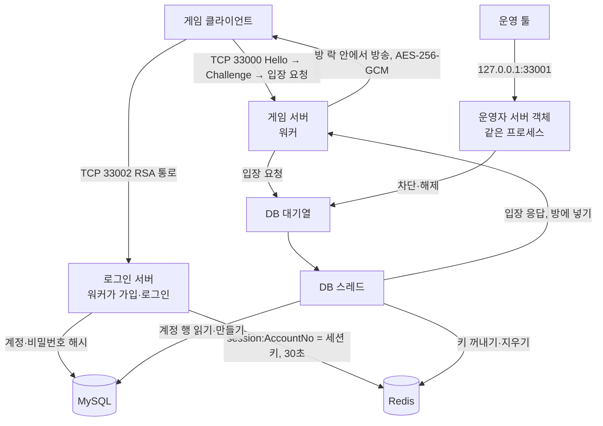

# 게임 서버 구조

**로그인 서버가 비밀번호를 확인하고 일회용 세션 키를 Redis에 넣으면, 게임 서버는 그 키로 잠근 입장 요청을 확인한 뒤 키를 지우고, 그 뒤 모든 메시지를 그 키로 암호화한다(인증 분산).** 두 서버 모두 같은 네트워크 라이브러리를 상속한 별도 exe이고, 서로 직접 연결하지 않는다. 게임 서버의 컨텐츠는 채팅방 하나다 - 입장·DB·암호화를 시험으로 먼저 다지고 컨텐츠는 그 위에 붙이기로 했다(2026-11-20 범위 축소).

- 기준 코드: 2026-11-21, `Game/Server/`, `Game/Login/`, `Game/Protocol/`, `Game/Admin/`, `Game/Client/`, `Game/Bot/`
- 클라 한 명이 겪는 순서대로 단계마다 스레드·락을 따라가는 설명은 [게임 서버 흐름](design/게임서버_클라_흐름.docx)·[로그인 서버 흐름](design/로그인서버_흐름.docx), 로그인 서버 구조와 결정 과정은 [로그인 서버 구조](로그인서버_구조.docx), 입장 설계는 [게임 서버 입장 변경](design/게임서버_입장_변경.docx) 2판

## 1. 전체 그림

- **라이브러리 사용 방식:** 두 서버는 `NetworkLib`를 상속해 `OnAccept`·`OnRecv`·`OnRelease`만 구현하고 세션은 ID로만 다룬다.
- **서버 객체 두 개:** 게임 서버 프로세스에는 게임 서버(33000)와 운영자 서버(127.0.0.1:33001)가 같은 라이브러리로 떠 있다. 이 구성을 만들며 라이브러리 버그를 하나 찾았다(6장).

## 2. 스레드

| 스레드          | 개수 | 하는 일                              |
| --------------- | ---- | ------------------------------------ |
| 게임 서버 워커  | 2    | Hello·입장 요청 모양 확인, 채팅 방송 |
| DB 스레드       | 1    | 입장 확인(Redis), 계정 행, 운영 명령 |
| 입장 기한 감시  | 1    | 60초 안에 입장하지 않은 연결 끊기    |
| 운영자 서버     | 1+1  | 워커 1(운영 명령), 인증 기한 감시 1  |
| main, 모니터    | 2    | 시작·종료, 1초마다 통계              |
| 로그인 서버워커 | 2    | 가입·로그인 전부(해시, MySQL, Redis) |

**게임 서버 워커는 블록되는 일을 하지 않는다.** Redis·MySQL을 기다리는 입장 확인은 `HoldSession`(세션이 해제되지 않게)을 건 뒤 DB 스레드에 넘기고 바로 돌아간다. DB 스레드가 결과를 보내고 `UnholdSession`을 부르므로, 그사이 클라가 끊겨도 `OnRelease`는 결과 처리 뒤에 온다.

- 버린 안: 워커에서 바로 Redis·DB 읽기 - 그동안 그 워커가 맡은 다른 세션이 모두 멈춘다.
- DB 스레드는 하나다. 입장과 운영 명령이 같은 계정을 동시에 올리지 않아, "메모리에 있나 → 없으면 DB에서 읽기"를 락 하나로 묶지 않아도 된다.

**로그인 서버는 반대로 워커가 해시까지 한다(인증 스레드 없음).** 워커마다 DB·Redis 연결 쌍을 하나씩 빌려 쓰고, 해시(Argon2id 64MiB·2회, 약 58ms - PC B) 동안 그 워커는 막힌다. 해시가 동시에 2개까지 돌아 로그인 처리량은 인증 스레드 하나일 때의 두 배가 되지만, 해시 중에 연 접속의 HelloClient는 늦는다(DB를 6초 잠근 시험에서 3.9초). 근거와 시험은 [로그인 서버 구조](로그인서버_구조.docx) 3장.

## 3. 입장(인증 분산)

**게임 서버는 비밀번호를 모른다.** 로그인 서버가 준 세션 키를 가졌는지만 확인한다.

1. 로그인 서버: 비밀번호를 확인하면 세션 키 32바이트를 만들어 Redis `session:<AccountNo>`에 30초 넣고, RSA 통로로 클라에게도 준다
2. 클라 → 게임 서버: Hello [type | AccountNo] 평문
3. 게임 서버 워커: 이 연결의 SeqNumber 시작값(무작위 8바이트)을 만들어 Challenge로 보낸다
4. 클라: 입장 요청 = [type | SeqNumber = 시작값](평문, 인증 데이터) + 세션 키로 잠근 AccountNo + 태그(AES-256-GCM)
5. 워커: 모양과 SeqNumber가 시작값인지 보고 DB 스레드에 넘긴다 - 다른 연결에서 가로챈 입장 요청은 시작값이 달라 여기서 끊긴다
6. DB 스레드: Redis에서 키를 꺼내 풀어 본다. 태그가 맞으면 키를 지운다(읽은 값과 같을 때만, EVAL 한 번 - 같은 키로 두 연결이 와도 하나만 들어온다)
7. DB 스레드: 계정 행을 읽거나 만들고, 차단이면 거절. 같은 계정이 이미 입장해 있으면 기존 연결을 끊고 새 연결로 바꾼다
8. DB 스레드: 방 락 안에서 상태를 Entered로 바꾸고 입장 응답을 보내고 방에 넣는다

| 결정             | 선택                         | 버린 안                     |
| ---------------- | ---------------------------- | --------------------------- |
| 인증 넘기기      | Redis 세션 키(30초, 한 번만) | 서버끼리 직접 연결, DB 토큰 |
| 리플레이 막기    | 연결마다 SeqNumber 시작값    | 클라가 정하는 번호          |
| 패킷 모양        | 입장 요청부터 하나로 통일    | 입장 증명 전용 MAC          |
| 같은 계정 재입장 | 기존 연결 끊고 새 연결 입장  | 새 입장 거절                |
| 실패 응답        | 없이 끊기                    | 이유를 알려 줌              |

- **서버끼리 직접 연결하지 않는 이유:** 라이브러리는 받는 쪽(`AcceptEx`)만 있다. 서버 간 연결을 넣으면 재연결·상대 다운 처리까지 라이브러리 일이 커진다.
- **같은 계정 재입장:** 클라 전원이 꺼져 FIN·RST가 오지 않으면 서버는 이전 연결이 살아 있다고 본다. 새 입장을 거절하면 그 사용자는 연결 감시가 끊을 때까지 못 들어온다.
- **실패 응답 없이 끊기:** 키가 없는지·틀렸는지·차단인지 알려 주면 맞혀 보기에 쓰인다. 정상 클라는 다시 로그인하면 된다.
- 접속한 뒤 60초 안에 입장하지 않으면 끊는다(입장 처리 중은 제외) - 아무것도 보내지 않는 연결이 세션 칸을 채우지 못하게.
- 비정상 입력 26개는 [입장 비정상 테스트 케이스](verification/게임서버_입장_비정상_테스트케이스.docx)로 정하고 `entry_bad.ps1`이 판정한다.

## 4. 암호 통로

**입장 요청부터 모든 패킷이 [type | SeqNumber](평문, 인증 데이터) + 암호문 + 태그 하나의 모양이다.** 논스 = 방향 4바이트 + SeqNumber 8바이트, 두 방향 모두 시작값부터 메시지마다 1씩 올린다. 받는 쪽은 SeqNumber가 기대값과 같을 때만 풀어, 다시 보내기·빠뜨리기·순서 바꾸기는 SeqNumber가, 바꿔치기는 태그가 막는다.

- **암호:** AES-256-GCM(Windows CNG). 로그인 구간은 RSA 2048만 쓰고, 그 뒤는 세션 키로 대칭 암호를 쓴다 - RSA 에코 측정에서 요청 시간의 96%가 비밀 키 연산이었고, AES 에코는 메시지 하나가 약 1,000배 빨랐다(PC B, [RSA·AES 에코 비교](design/RSA_AES에코_비교.docx)).
- **순서는 컨텐츠가 지킨다:** 한 세션에 워커(다른 사람의 채팅 방송)와 DB 스레드(입장 응답)가 동시에 보낼 수 있다. SeqNumber 7·8로 잠근 메시지가 8, 7 순서로 송신 링에 들어가면 클라가 거절한다. 그래서 모든 송신은 `sendGame` 하나를 거치고, 그 칸의 송신 락 안에서 "세션 ID 확인 → SeqNumber → 암호화 → `SendPacket`"을 한 번에 한다. 세션 ID를 확인하는 것은 끊긴 세션의 칸을 새 세션이 쓸 때, 옛 ID로 보내던 스레드가 새 세션의 번호를 올리지 않게 하려는 것이다.
- **라이브러리를 고치지 않았다:** 라이브러리는 받은 바이트를 그대로 보낸다. 암호화를 라이브러리 API로 넣지 않은 대신 세션마다 송신 링을 둔 설계(공유 버퍼 없음)가 이 구조를 받친다.

## 5. 채팅방과 락

**방 락 안에서 구성원 모두의 송신 링에 넣는다.** 그래서 받는 사람 모두 같은 순서로 받는다(두 사람이 동시에 30줄씩 보내도 받는 세 사람의 순서가 같다 - `chat.ps1`). 라이브러리는 링에 넣기만 하고 `WSASend`는 워커가 꺼낸 완료를 다 처리한 뒤에 부르므로 락 안이 짧다.

| 락                   | 지키는 것                        |
| -------------------- | -------------------------------- |
| 방 락                | 방 구성원 목록                   |
| 송신 락(세션 칸마다) | 상태, 보내는 키·SeqNumber        |
| 계정 표 락           | 아이디 → 계정, 접속 표시         |
| 계정 락              | 차단 시각                        |
| DB 대기열 락         | 입장·운영 명령 대기열(가장 안쪽) |

**락 순서: 방 → 송신 → 라이브러리 세션 락, 계정 표 → 계정.** 두 줄을 함께 잡는 곳은 없고, `Disconnect`는 게임 락 밖에서 부른다 - 끊긴 세션의 `OnRelease`가 방 락·계정 표 락을 잡기 때문이다. 표 전체(감시·운영자 칸 락 포함 7개)와 락마다 잡는 스레드는 [게임 서버 흐름](design/게임서버_클라_흐름.docx) 0-4.

**시험이 찾은 순서 버그 둘** - 둘 다 "알리고 나서 상태를 바꾸면 상대가 먼저 움직인다"였고, 짧은 기능 시험은 통과하고 봇 30개가 입장을 반복하는 시험(5분, 1시간)에서 드러났다.

- 입장 응답을 보낸 뒤 통로를 열어, 클라가 받자마자 보낸 첫 암호문을 워커가 평문 명령으로 보고 끊었다. 같은 송신 락 안에서 통로를 먼저 열고 보낸다([에러 기록 2-14](../README_ERRORS.md)).
- 입장 응답을 보낸 뒤 방에 넣어, 응답을 받자마자 보낸 첫 채팅이 보낸 사람에게만 돌아오지 않았다(1시간 시험 입장 1,771번 중 6번). 방 락 안에서 응답과 방 넣기를 한 번에 한다(2-16).

## 6. 계정 저장과 운영 툴

**MySQL `accounts` 표는 아이디·차단 시각·만든 시각만 둔다.** 처음 입장할 때 DB 스레드가 읽거나 만들고, 서버가 끝날 때까지 메모리에서 내리지 않는다. 비밀번호 해시는 로그인 서버의 표에 있다.

- **DB 연결 끊김:** MySQL 오류 2006·2013이면 다시 연결한다. 읽기는 다시 붙어 한 번 더 하고, 트랜잭션은 COMMIT 전에 끊겼을 때만 다시 한다(`reconnect.ps1`이 서버 연결을 KILL해 확인).
- **운영 툴:** `AdminTool.exe`의 `ban <아이디> <분>`·`unban <아이디>`를 운영자 포트로 보낸다. 운영자 서버는 127.0.0.1에만 묶고, 첫 패킷이 운영자 키가 아니거나 5초 안에 오지 않으면 끊는다. 명령은 DB 스레드에서 처리한다 - 이번 실행에서 입장하지 않은 계정은 DB에만 있는데, 계정을 올리는 입장도 DB 스레드라 그동안 그 계정이 메모리에 올라오지 않는다. 접속 중인 계정을 차단하면 끊는다.

**두 번째 서버 객체를 붙이며 찾은 라이브러리 버그.** 라이브러리는 "이 스레드가 워커인가"를 `static thread_local` 워커 번호 하나로만 판단했다. 운영자 서버의 워커가 게임 플레이어에게 `SendPacket`하면 자기를 게임 서버의 워커로 여겨 게임 세션을 자기 송신 목록에 올리고, 게임 서버의 카운터를 자기 번호로 읽었다. 워커마다 소속 객체를 함께 기록하고, 다른 객체의 워커는 워커 밖 스레드처럼 송신을 맡기도록 고쳤다([에러 기록 2-13](../README_ERRORS.md)).

## 7. 종료 순서

**새 일을 넣는 쪽을 먼저 멈추고, DB 스레드가 남은 일을 끝낸 뒤 라이브러리를 멈춘다.**

1. 입장 기한 감시를 멈춘다
2. 종료 표시를 세우고 처리 중인 패킷·운영 명령이 끝나기를 기다린다(처리 중 수를 먼저 올리고 표시를 보므로 둘 중 하나는 반드시 상대를 본다)
3. DB 스레드를 멈춘다 - 남은 입장 결과를 보내고 `UnholdSession`까지 부른다
4. 게임 서버 라이브러리 `Stop`, 그다음 운영자 서버

## 8. 검증

| 시험              | 확인한 것                                   | 결과        |
| ----------------- | ------------------------------------------- | ----------- |
| `auth_ok.ps1`     | 가입 → 세션 키 → 첫 입장·두 번째 입장       | 10판정 PASS |
| `entry_bad.ps1`   | 입장 비정상 테스트 케이스 26개              | 21판정 PASS |
| `run_all.ps1`     | 로그인·채팅·재시작·DB 재연결·운영 툴 등 6개 | 59판정 PASS |
| `login_edge.ps1`  | 두 서버 경계(장애·기한·대기열 상한)         | 43판정 PASS |
| `login_flood.ps1` | Hello만 보내는 접속 폭주 뒤 정상 로그인     | 9판정 PASS  |
| 1시간·봇 30개     | 입장 1,770, 채팅 6만, 오류 0, 메모리 그대로 | 13판정 PASS |

- 시험마다 필요한 계정을 DB에 직접 만들어 서로 기대지 않고 몇 번이든 다시 돌릴 수 있다. 시험별 내용은 [게임 테스트 케이스](verification/game_test_cases.md), 봇 부하 시험은 [봇 부하 시험 기록](verification/game_soak.md).

## 9. 한계

- 컨텐츠가 채팅방 하나다.
- 계정을 메모리에서 내리지 않는다. 가입 수 제한, 비밀번호 변경·찾기가 없다.
- 로그인 서버의 서버 임시 키는 256개이고 HelloServer 뒤 끊기 전인 연결이 모두 쥐고 있으면 새 접속을 끊는다 - 접속 256개를 10초마다 새로 열면 로그인이 계속 막힌다(주소별 제한 없음).
- 로그인이 틀리면 그 연결은 다음 요청을 받지 않지만(한 연결에 한 번, 2026-11-21 - 전에는 5번), 다시 접속하면 그만이다(계정·주소별 제한 없음).
- MySQL이 멈추면(표 잠김, 응답 없음) 로그인 서버 워커가 문장 하나에 읽기 제한(30초)만큼 막히고, 끊겼다고 보고 한 번 더 읽어 그 두 배까지 걸릴 수 있다. 워커가 2개라 둘 다 걸리면 HelloServer도 처리되지 않는다. Redis처럼 "실패 뒤 몇 초는 바로 실패"를 넣지 않고 받아들였다(2026-11-21 사용자 결정 - 워커가 해시까지 하기로 한 구조의 대가).
- 로그인 요청 서명에 연결마다 다른 서버 값이 없어, 서버 임시 키를 다시 쓰는 연결에서는 엿들은 요청을 그대로 다시 보낼 수 있다(cpp-reviewer 리뷰). 키를 꺼내는 순서를 큐로 하고 한 키를 2연결까지만 써서 시도 횟수를 늘렸다 - 막은 것은 아니다(2026-11-21 사용자 결정). 공격자는 엿들은 클라 공개 키로 다시 접속하며 받은 서버 공개 키를 비교하면 되고, 필요한 접속은 노리는 키 앞에 있던 키 수(최대 255개)만큼이다(스택일 때는 1번). 시간 제한은 사실상 없다.
- 한 키를 2연결까지만 쓰므로, 해제하는 워커가 키를 새로 만드는 일(약 51ms - PC B)이 두 연결마다 한 번이다(5연결일 때의 2.5배, 연결 하나당 평균 약 26ms). 워커 2개면 HelloServer만 보내고 끊는 접속이 초당 약 78개를 넘을 때 두 워커가 키 만들기만 해 다른 사용자의 로그인이 늦어진다(5연결일 때는 약 200개). 서버를 끌 때는 `RsaKeyPool::StopRefill`로 새로 만들지 않는다(끄는 동안 해제마다 키를 만들면 연결 256개에 약 3.5초 늦어졌다).
- 서버·봇·MySQL·Redis를 한 PC 루프백에서 시험했다.
