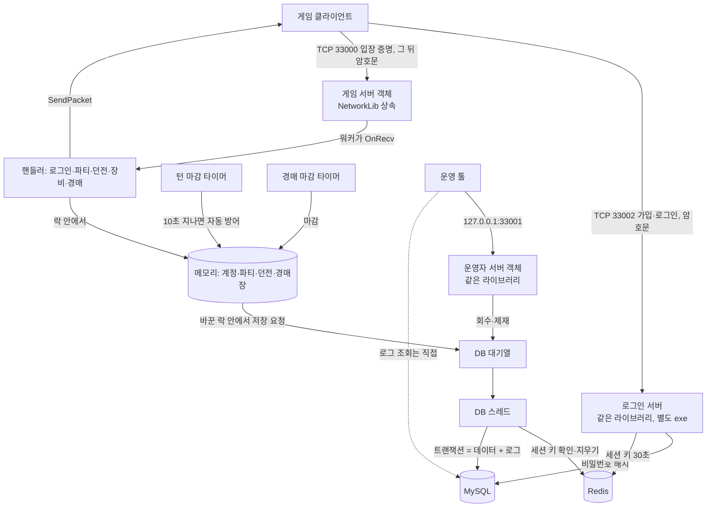

# 게임 서버 구조

**워커 스레드가 패킷을 바로 처리하고, 여러 스레드가 함께 만지는 데이터는 단위마다 락(계정 표·파티 표·파티·플레이어·경매장)으로 지키며, 저장은 DB 스레드 하나가 넣은 순서대로 MySQL에 쓰는 구조다.** 접속 중에는 메모리가 기준이고, 골드·아이템이 바뀔 때마다 그 메모리를 바꾼 락 안에서 저장 요청을 넣어 DB에도 같은 순서로 들어간다. 가입·로그인은 따로 둔 로그인 서버가 맡고, 게임 서버는 로그인 서버가 Redis에 넣은 세션 키로 입장을 확인한 뒤 모든 메시지를 그 키로 암호화한다(9장).

- 기준 코드: 2026-11-15, `Game/Server/`, `Game/Login/`, `Game/Protocol/`, `Game/Admin/`, `Game/Bot/`
- 게임: 2–4명이 파티를 꾸려 방 5개짜리 던전을 턴제로 돌고(턴 10초), 얻은 아이템을 경매장에서 사고판다. 운영 툴로 아이템 회수·접속 제재
- 결정 과정(선택지·추천·결정)은 [게임 서버 설계](design/게임서버_설계.docx), 클라 한 명이 겪는 순서대로 단계마다 스레드·락을 따라가는 설명은 [처리 흐름](design/게임서버_흐름.docx)에 있다

## 1. 전체 그림

- **라이브러리 사용 방식:** 게임 서버는 `NetworkLib`를 상속해 `OnAccept`·`OnRecv`·`OnRelease`만 구현한다. 세션은 ID로만 다룬다.
- **서버 객체 두 개:** 한 프로세스에 게임 서버(포트 33000)와 운영자 서버(127.0.0.1:33001)를 같은 라이브러리로 띄운다. 이 구성을 만들며 라이브러리 버그를 하나 찾았다(8장).

## 2. 스레드

| 스레드           | 개수 | 하는 일                             |
| ---------------- | ---- | ----------------------------------- |
| 게임 서버 워커   | 2    | 패킷 처리(`OnRecv`), 접속·해제 콜백 |
| 턴 마감 타이머   | 1    | 차례 10초가 지나면 자동 방어        |
| 경매 마감 타이머 | 1    | 경매 기간이 끝나면 정산             |
| DB 스레드        | 1    | 저장, 입장 확인(Redis)·계정 읽기    |
| 운영자 서버      | 1+1  | 워커 1(운영 명령), 인증 기한 감시 1 |
| main, 모니터     | 2    | 시작·종료, 1초마다 통계             |

**워커가 패킷을 바로 처리한다(로직 스레드를 두지 않는다).**

- 버린 안: 워커는 패킷을 큐에 넣고 로직 스레드 하나가 모든 게임 상태를 처리한다. 락이 필요 없어 정합성은 쉽지만, 서로 다른 파티와 경매장이 한 줄로 기다리고, 라이브러리의 "워커가 바로 처리" 설계를 쓰지 못한다.
- 대가: 서로 다른 세션의 콜백이 여러 워커에서 동시에 불리므로, 공유 데이터는 단위마다 락으로 지킨다(3장). 같은 세션의 `OnRecv`는 동시에 불리지 않으므로 세션마다의 상태(`Player`)는 락이 없다.

**워커 밖 스레드는 송신만 하고, 해제·`WSASend`는 라이브러리가 워커로 넘긴다.** 타이머와 DB 스레드도 `SendPacket`을 부르지만 실제 송신은 라이브러리가 워커에서 건다. 워커 밖 스레드는 라이브러리 `Stop` 전에 멈춘다(10장).

로그인 서버는 별도 exe다(워커 2, 인증 스레드 1, 모니터 1). 해시·MySQL·Redis는 모두 인증 스레드에서 하고 워커는 패킷을 확인해 넘기기만 한다(9장).

## 3. 데이터와 락

| 데이터                     | 위치           | 보호                   |
| -------------------------- | -------------- | ---------------------- |
| 세션의 계정·파티 번호      | `Player`       | 없음(세션마다 하나씩)  |
| 아이디→계정, 접속 목록     | `AccountTable` | 계정 표 락             |
| 골드·아이템·장비·차단 시각 | `Account`      | 플레이어 락(가장 안쪽) |
| 파티 번호→파티             | `PartyTable`   | 파티 표 락(찾고 놓음)  |
| 파티원·상태·던전           | `Party`        | 파티 락                |
| 경매 목록·구경꾼           | `AuctionHouse` | 경매장 락              |
| 마감·저장 요청             | 대기열 셋      | 대기열 락(가장 안쪽)   |

**락 순서: 계정 표 → 파티 표 → 파티 → 플레이어, 경매장 → 플레이어, 어느 락이든 → 대기열.**

- 파티 표 락과 파티 락, 파티 락과 경매장 락은 함께 잡지 않는다. 경매 등록 전 "던전 중인가"는 파티 락으로 확인하고 놓은 뒤 경매장 락을 잡는다.
- 플레이어 락은 한 번에 하나만 잡는다. 입찰은 새 입찰자 락에서 골드를 빼고 놓은 뒤 이전 입찰자 락에서 돌려준다.
- 플레이어 락이 필요한 이유: 계정은 주인의 워커만 만지지 않는다 - 이전 입찰자 환불(새 입찰자의 워커), 경매 정산(타이머), 회수(DB 스레드), 던전 보상(그 턴을 처리한 워커나 타이머).
- 타이머 콜백은 대기열 락을 놓은 뒤 부른다. 콜백이 파티 락·경매장 락을 잡는데 반대 순서(파티·경매장 → 대기열)가 이미 있기 때문이다.

**`Player`의 파티 번호는 힌트다.** 쓸 때마다 파티 락 안에서 내가 정말 파티원인지 확인하고, 아니면 0으로 고친다. 파티는 표에 `shared_ptr`로 두어, 찾아 둔 파티가 그사이 표에서 빠져도 메모리는 남는다.

## 4. 로그인과 계정

**계정은 처음 로그인할 때 DB에서 읽고, 서버가 끝날 때까지 메모리에서 내리지 않는다.** 파티원·던전·경매가 계정 주소를 들고 있어도 안전하다(로그아웃은 접속 표시만 지운다).

**입장은 DB 스레드가 확인하고, 그동안 세션을 붙잡는다.** 입장 확인(Redis)과 처음 보는 계정 읽기(MySQL)가 모두 블록되기 때문이다.

1. 워커: `HoldSession`(세션이 해제되지 않게), 로그인 중 표시, DB 대기열에 넣고 바로 돌아간다 - 워커는 Redis·DB를 기다리지 않는다
2. DB 스레드: Redis의 세션 키로 입장 증명을 확인하고 키를 지운다(9장)
3. DB 스레드: 이번 실행에서 처음 보는 계정이면 읽거나(없으면 골드 100·회복약으로) 만든다
4. DB 스레드: 계정 표에 넣고 `Player`에 계정 주소를 넣은 뒤 **로그인 중 표시를 내리고**, 암호 통로를 연 뒤 응답하고, `UnholdSession`

- 버린 안: 서버 시작 때 모든 계정을 읽기(계정이 많으면 느리다), 워커에서 바로 Redis·DB 읽기(그동안 그 워커의 다른 세션이 모두 멈춘다).
- 계정을 메모리에 올리는 것은 DB 스레드뿐이다(입장·운영 명령). 그래서 "계정 표에 있는가 → 없으면 DB에서 읽기"를 락 하나로 묶지 않아도 겹치지 않는다.
- 순서가 중요했다: 처음에는 응답을 보낸 뒤 표시를 내리고, 워커는 계정을 먼저 읽고 표시를 나중에 읽었다. 그 사이에 같은 세션이 다른 아이디로 또 로그인하면 한 세션이 두 계정에 로그인되고, 끊길 때 뒤 계정만 로그아웃돼 첫 아이디가 재시작까지 잠겼다(비밀번호가 없어 남의 아이디도 잠글 수 있었다). 리뷰로 찾아 "표시를 먼저 읽고, 표시를 내린 뒤 응답"으로 고쳤다.
- 접속한 뒤 60초(`entryLimitSec`) 안에 입장하지 않거나, 한 연결에서 입장 확인을 3번 틀리면 끊는다 - 아무것도 보내지 않는 연결이 세션 칸을 채우거나, 틀린 입장으로 저장과 같은 DB 스레드를 붙잡지 못하게(경계 시험에서 찾아 넣음). 입장 처리 중(DB 대기열)은 끊지 않는다.
- 같은 아이디가 이미 접속 중이면 이전 접속을 끊는다. 클라의 전원이 꺼져 FIN·RST가 오지 않으면 서버는 이전 접속이 살아 있다고 보기 때문이다.

## 5. 파티와 던전

**던전은 규칙만 아는 클래스(`Dungeon`)이고, 파티 락 안에서만 불린다.** 판정 결과를 이벤트 목록으로 돌려주고, 보내는 것은 게임 서버가 한다. 그래서 파티원 모두 같은 이벤트를 같은 순서로 받는다(4명 던전 시험에서 남은 셋의 이벤트 109–112줄이 같았다).

- **전투 값은 시작할 때 복사한다.** 체력·공격·방어·조사는 던전을 시작할 때 장비에서 읽어 던전 상태에 복사하고, 전투 중에는 계정을 보지 않는다. 계정을 만지는 곳은 회복약을 찾거나 쓸 때, 보상을 줄 때뿐이다(파티 락 → 플레이어 락). 던전 중 장비 변경은 거절한다.
- **턴 10초는 타이머 스레드 하나 + 마감 시각 순 대기열로 잰다.** 차례가 바뀔 때마다 (마감, 파티, 턴 번호)를 넣고, 깨면 파티 락 안에서 턴 번호가 그대로일 때만 자동 방어한다. 옛 항목은 지우지 않고 턴 번호로 거른다. 턴 번호는 파티 안에서 던전이 바뀌어도 이어 센다 - 새 던전이 1부터 다시 세면 지난 던전의 남은 마감 "턴 5"가 새 던전의 턴 5에 걸린다.
- **끊긴 파티원은 바로 뺀다.** 차례였으면 10초를 기다리지 않고 다음 사람에게 넘긴다. 차례가 그대로인 알림을 다시 보낼 때는 남은 시간을 싣는다.
- **보상:** 보스를 잡으면 파티 락 안에서 전리품을 굴리고(파티원 전원 d20, 가장 높은 사람), 파티원마다 플레이어 락을 잠깐 잡아 골드·아이템을 넣고 같은 락 안에서 저장을 넣는다. 인벤토리가 가득 차면 버리고 알린다.

## 6. 경매장

**경매장 락 하나로 목록과 구경꾼을 지키고, 알림을 락 안에서 보낸다.** 구경꾼 모두 등록·입찰·마감을 같은 순서로 받는다.

- **아이템은 한곳에만 있다.** 등록하면 계정에서 빠져 경매장이 보관하고, 마감 때 낙찰자나 판매자에게 간다. 버린 안(아이템은 계정에 두고 표시만): 착용·사용·회수할 때마다 경매를 함께 확인해야 한다.
- **입찰 골드는 미리 뺀다.** 밀리면 돌려준다. 그래서 낙찰 때 골드가 모자라는 일이 없다(낙찰자 인벤토리가 가득 찬 경우만 취소·환불).
- **알림 폭주를 막는다.** 최소 인상폭 5%(최소 1), 세션마다 입찰 간격 100ms, 최고 입찰자 재입찰 금지, 전체 1000건, 목록은 쪽 넘기기. 리뷰에서 "공짜 계정 여럿이 1골드씩 올리면 구경꾼마다 알림이 쌓여 정상 구경꾼이 송신 링 넘침으로 끊긴다"는 경로를 찾아 넣었다.
- **마감은 경매 마감 타이머(턴 타이머와 같은 클래스의 두 번째 인스턴스)가 한다.** 판매자·입찰자가 접속해 있지 않아도 계정은 메모리에 있어 그 계정에 넣는다.

## 7. 저장(MySQL)

**DB 스레드 하나 + 요청 대기열.** 워커는 요청을 넣고 바로 돌아간다. 요청은 넣은 순서대로 하나씩, 요청 하나가 트랜잭션 하나(데이터 + 로그)다.

| 결정             | 선택                          | 버린 안              |
| ---------------- | ----------------------------- | -------------------- |
| 저장 시점        | 바뀔 때마다                   | 로그아웃 때 한꺼번에 |
| 요청을 넣는 자리 | 메모리를 바꾼 락 안           | 락을 놓은 뒤         |
| 골드 쓰기        | 증감(gold = gold + n)         | 메모리 값 그대로     |
| 아이디           | VARBINARY + X'16진수'         | 이스케이프 문자열    |
| 재시작           | 열린 경매 취소·환불           | 경매 이어 가기       |
| 연결 끊김        | 다시 연결, COMMIT 전만 재실행 | 다시 연결 안 함      |

- **바뀔 때마다:** 서버가 죽어도 거래·전리품이 남고, 회수·로그와 맞추기 쉽다.
- **바꾼 락 안에서:** 대기열은 넣은 순서대로 쓰므로, 같은 데이터를 바꾼 순서가 DB에도 같다. 처음에는 낙찰 저장을 낙찰자 락을 놓은 뒤 넣었는데, 그 틈에 받은 아이템을 착용하면 착용 저장이 먼저 들어가고 뒤의 낙찰 저장이 착용을 지워 재시작하면 장비가 벗겨졌다(리뷰로 찾음).
- **증감:** 상대방 골드(입찰 환불, 판매 대금)는 같은 트랜잭션에 묶으려고 다른 락 안에서 넣는데, 증감이라 순서가 바뀌어도 값이 같다. 변경마다 로그에 `gold_delta`를 남겨 계정 골드 = 로그 합계로 검증한다.
- **연결 끊김:** 오류 2006·2013이면 다시 연결한다. COMMIT 전에 끊긴 트랜잭션은 서버가 이미 되돌렸으니 한 번 더 실행하고, COMMIT 중 끊김은 반영 여부를 몰라 다시 하지 않는다(골드 증감이 두 번 들어가면 안 된다). 연결·읽기·쓰기 타임아웃으로 DB가 응답하지 않아도 DB 스레드가 영영 멈추지 않는다.

## 8. 운영 툴

**운영자 포트는 같은 라이브러리로 띄운 두 번째 서버 객체다.** 운영 툴(`AdminTool.exe`)은 회수·제재를 이 포트로 명령하고, 로그 조회는 DB를 직접 읽는다.

- **운영 명령은 DB 스레드에서 처리한다.** 이번 실행에서 로그인하지 않은 계정은 DB에만 있는데, 계정을 읽는 로그인도 DB 스레드라 처리하는 동안 그 계정이 메모리에 올라오지 않는다 - DB만 고쳐도 안전하다.
- **회수 순서:** ① 경매 중이면 경매를 취소하고 입찰자에게 환불 ② 메모리 계정의 인벤토리면 플레이어 락 안에서 꺼내고 저장(착용 중이면 벗긴다) ③ 아니면 DB에서 지운다. ③에서 주인이 메모리에 있으면 "옮겨졌거나 쓰임 - 다시 시도".
- **보호:** 127.0.0.1에만 묶고(라이브러리에 바인드 설정을 더함), 첫 패킷은 운영자 키, 접속 후 5초 안에 키가 없으면 끊는다 - 키 없이 붙어만 있는 연결이 몇 안 되는 세션 칸을 막지 못하게.

**두 번째 객체를 붙이며 찾은 라이브러리 버그.** 라이브러리는 "이 스레드가 워커인가"를 `static thread_local` 워커 번호 하나로만 판단했다. 운영자 서버의 워커가 게임 플레이어에게 `SendPacket`하면 자기를 게임 서버의 워커로 여겨 게임 세션을 자기 송신 목록에 올리고, 게임 서버의 카운터를 자기 번호로 읽었다. 워커마다 소속 객체를 함께 기록하고, 다른 객체의 워커는 워커 밖 스레드처럼 송신을 맡기도록 고쳤다([에러 기록 2-13](../README_ERRORS.md)).

## 9. 로그인 서버와 암호화

**가입·로그인은 따로 둔 로그인 서버가 맡고, 게임 서버와는 직접 연결하지 않고 Redis를 거쳐 세션 키를 넘긴다.** 로그인 서버는 비밀번호를 확인하면 30초짜리 세션 키를 Redis에 넣고 클라에게도 준다. 게임 서버는 그 키로 만든 입장 증명을 확인한 뒤 키를 지우고, 그 뒤의 메시지는 그 키에서 파생한 키로 암호화한다. 결정 과정은 [로그인 서버 설계](design/login_server.docx).

| 결정             | 선택                    | 버린 안                 |
| ---------------- | ----------------------- | ----------------------- |
| 로그인 서버 위치 | 별도 exe                | 게임 서버 안 객체       |
| 인증 넘기기      | Redis 세션 키(30초)     | DB 토큰, 서버 직접 연결 |
| 비밀번호 저장    | Argon2id + 솔트 + 페퍼  | PBKDF2, SHA-256         |
| 로그인 구간      | 서명 + 임시 키 + AEAD   | TLS, 평문               |
| 게임 구간        | 컨텐츠가 세션 키로      | 라이브러리 API          |
| 입장 증명        | 키 MAC + EnterChallenge | AEAD(논스 0)            |
| Redis 클라이언트 | 명령 넷 직접(RESP)      | hiredis                 |

- **서버끼리 직접 연결하지 않는 이유:** 라이브러리는 받는 쪽(`AcceptEx`)만 있다. 서버 간 연결을 넣으면 재연결·상대 다운 처리까지 라이브러리 일이 커진다. Redis를 거치면 두 서버 모두 지금 라이브러리를 그대로 쓴다.
- **비밀번호:** Argon2id(64MiB·2회 - 이 PC에서 재서 최대값까지 100ms 안인 조합 중 메모리가 가장 큰 것)에 솔트와 페퍼(DB 밖의 서버 비밀)를 섞는다. 해시는 일부러 느려서 워커가 아니라 인증 스레드에서 한다.
- **로그인 구간:** 양쪽이 연결마다 임시 X25519 키를 만들어 키를 나누고, 서버는 고정 Ed25519 키로 서명해 진짜 서버임을 보인다. 임시 키를 버리므로 나중에 서버 키가 새도 지난 로그인은 풀 수 없다(전방 비밀성). TLS는 라이브러리의 길이 헤더 앞에 레코드 층을 따로 얹어야 해서 쓰지 않았다.
- **게임 구간을 컨텐츠에서 암호화한 이유:** 라이브러리를 고치지 않아도 된다. 대신 순서를 컨텐츠가 지킨다 - 한 세션에 워커·턴 타이머·경매 타이머·DB 스레드가 동시에 보낼 수 있어, 순번 7·8로 암호화한 메시지가 8, 7 순서로 송신 링에 들어가면 클라가 거절한다. 그래서 모든 송신이 `sendGame` 하나를 거치고, 그 칸의 송신 락 안에서 "세션 ID 확인 → 순번 → 암호화 → `SendPacket`"을 한 번에 한다. 칸의 세션 ID를 확인하는 것은 끊긴 세션의 칸을 새 세션이 쓸 때 옛 ID로 보내던 스레드가 새 세션의 순번을 올리지 않게 하려는 것이다.
- **입장 증명:** 처음에는 AEAD 확인 값(논스 0)으로 만들었는데, 증명이 틀리면 키가 남아 같은 키·논스로 여러 번 만들 수 있었고 이 방식은 확인 값 두 개로 위조가 된다(리뷰 지적). 논스 없는 키 MAC으로 바꾸고, 접속마다 게임 서버가 주는 무작위 값(`EnterChallenge`)을 넣어 엿본 입장 패킷을 다른 연결에서 다시 쓰지 못하게 했다.
- **세션 키 한 번만:** 증명이 맞을 때만, Redis의 값이 읽은 값과 같을 때만 지운다(EVAL 한 번). 같은 증명을 두 연결이 보내도 하나만 들어오고, 그사이 같은 계정이 다시 로그인해 덮어쓴 새 키는 지우지 않는다.

**시험이 찾은 순서 버그 둘** - 둘 다 "알리고 나서 상태를 바꾸면 상대가 먼저 움직인다"였다.

- 입장 응답을 보낸 뒤 통로를 열어, 클라가 받자마자 보낸 첫 암호문을 워커가 평문 명령으로 보고 끊었다. 기능 시험은 통과했고 장시간 시험(봇 2개)에서 드러났다. 같은 송신 락 안에서 통로를 먼저 열고 보낸다([에러 기록 2-14](../README_ERRORS.md)).
- 로그인 서버에서 "요청 중 표시 내리기"를 응답 뒤로 옮긴 수정이 평소 응답에도 적용돼, 응답 직후 다음 요청을 끊었다. 끊을 때만 응답 뒤에 내린다(2-15).
## 10. 종료 순서

**저장 요청을 넣는 쪽을 먼저 멈추고, DB가 남은 저장을 끝낸 뒤 라이브러리를 멈춘다.**

1. 턴 마감 타이머, 경매 마감 타이머를 멈춘다
2. 종료 표시를 세우고 처리 중인 패킷·운영 명령이 끝나기를 기다린다(처리 중 수를 먼저 올리고 표시를 보므로 둘 중 하나는 반드시 상대를 본다)
3. DB 스레드를 멈춘다 - 남은 저장을 모두 끝낸다. 그 뒤에 저장 요청이 오면 `Assert`(조용히 사라지지 않게)
4. 게임 서버 라이브러리 `Stop`, 그다음 운영자 서버

- DB 스레드는 입장 결과를 보내고 `UnholdSession`을 부르므로 라이브러리보다 먼저 멈춘다. 로그인 서버도 같은 순서다(새 패킷 막기 → 인증 스레드 → 라이브러리).
- 다시 켤 때는 지난 실행에서 열려 있던 경매를 취소하고 맡긴 것을 돌려준다. 아이템·경매 번호는 DB의 가장 큰 번호 다음부터 센다.

## 11. 검증

| 시험                              | 확인한 것                               |
| --------------------------------- | --------------------------------------- |
| `tools/game/run_all.ps1`          | 기능·로그인 8개, 판정 68개 PASS         |
| 장시간 5시간·봇 30개(연결 기한)   | 로그인 2,234번, 기한 끊김 0(PASS)       |
| 장시간 1시간·봇 30개(로그인 포함) | 로그인 460번 인증 실패 0(PASS)          |
| 장시간 1시간·봇 30개              | 누수·멈춤·오판·불일치 없음(PASS)        |
| 장시간 5시간·봇 30개              | 던전 2.4만 판, 메모리 53MB 그대로(PASS) |
| cpp-reviewer 리뷰                 | 기능마다 + 전체 1차·재검증              |

- 기능 시험은 시험마다 필요한 계정을 DB에 직접 만들어(로그인 정보 포함) 서로 기대지 않고 몇 번이든 다시 돌릴 수 있다 - [게임 서버 테스트 케이스](verification/game_test_cases.md). 아래 1·5시간 줄은 로그인 서버를 넣기 전에 돌렸다.
- 장시간 시험은 무엇을 잡으려는지부터 정하고 돌렸다 - [장시간 시험](verification/game_soak.md). 5시간 동안 던전 23,986판·입찰 56,729번·재접속 2,224번에서 메모리 53–54MB·핸들 705–710으로 늘지 않았고, 예상밖끊김 0, DB실패 0, 수락 = 해제, DB 골드 = 로그 합계.

## 12. 한계

- 계정을 메모리에서 내리지 않는다. 가입 수 제한, 비밀번호 변경·찾기가 없다 - 데모 범위. 로그인·암호화의 한계는 [로그인 서버 설계](design/login_server.docx) 10장
- 끊긴 플레이어가 다시 접속해도 파티·던전으로 돌아가지 않는다
- 회수·저장의 "성공"은 메모리에 반영됐다는 뜻이고 DB 저장은 대기열에 들어간 상태다. COMMIT 중 연결이 끊기면 메모리와 DB가 어긋날 수 있고 `DB실패` 통계로만 보인다
- 회수할 때 계정 표 락을 쥔 채 메모리 계정 전체를 돈다(계정이 많아지면 아이템 번호 → 주인 색인이 필요)
- 서버·봇·MySQL·Redis를 한 PC 루프백에서 시험했다
